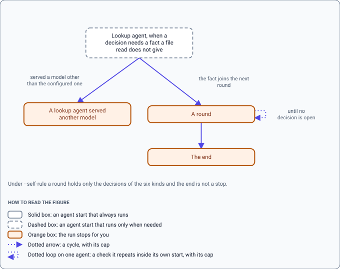
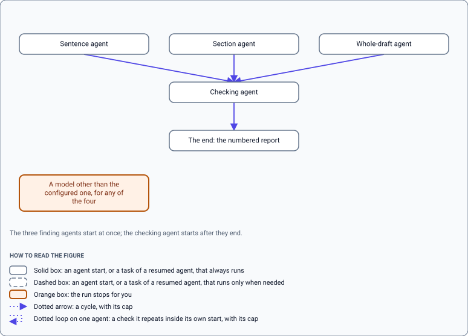
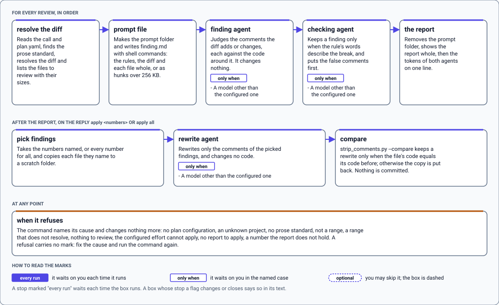
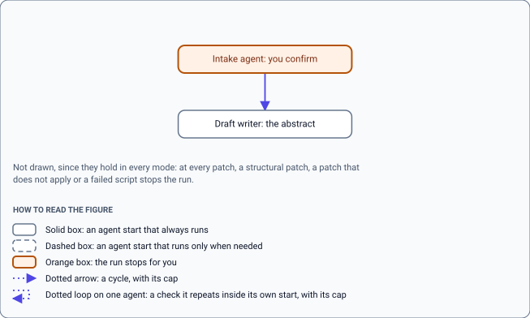
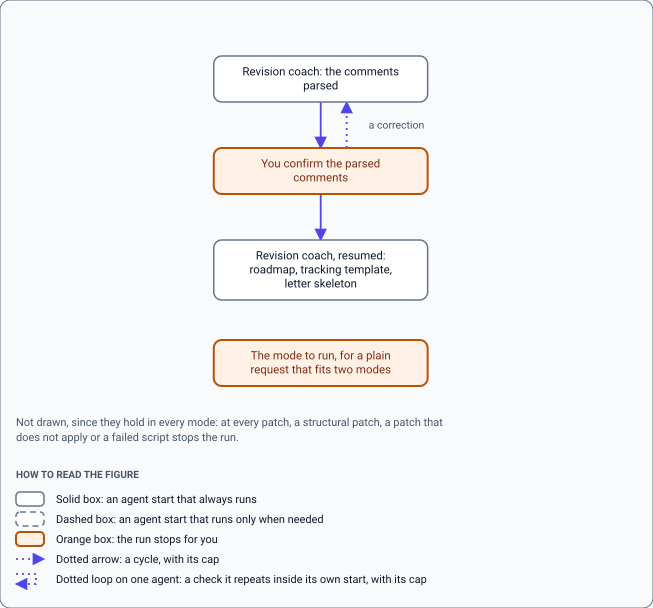
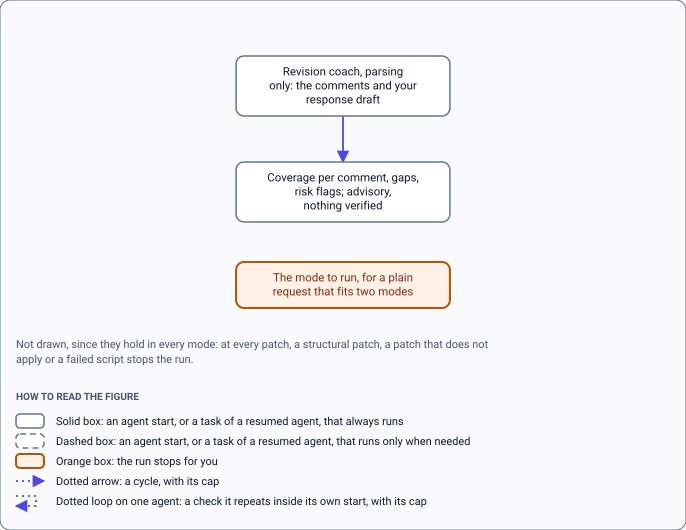
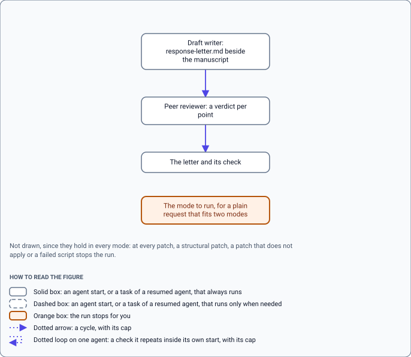

# Ordo

Ordo is a set of agent skills for Claude Code that run a multi-step change as a plan. The skills carry no project name and no path. Everything specific to a repository comes from that repository's `.agents/plan.yaml`. The same skills therefore run a C++ engine, a TypeScript tool or a research project.

One roadmap entry becomes a plan, kept in a ledger folder. Each step of the plan gets a brief, its written specification, and is built in its own git worktree. A fresh reviewer that changes nothing reviews the step. The step is cherry-picked onto `main` only after its checks pass there.

Around that loop, `repo-setup` and `ordo-init` set a repository up for it. `roadmap` keeps the entries the plans open, `grill` settles an entry's design decisions before its plan opens, `diagnose` finds the cause of a defect, inside a plan's loop or on its own, and `plan-retro` turns what the reviewers keep finding into rules. `session-retro` reads the transcripts of Claude Code sessions and proposes a change to a named rule, skill or brief for what went well and for what went wrong.

## The skills

| Skill | What it does |
|---|---|
| `repo-setup` | Sets up a new repository and then runs `/ordo-init`. It writes `CLAUDE.md` with the shared rules, the change and prose standards, the standards pages, a roadmap, a glossary, an ADR folder, `.gitignore` and `LICENSE`, and installs the project skills. `sync` keeps an existing repository's shared rules and its glossary's plan terms equal to their templates |
| `ordo-init` | Sets a repository up for the other skills. It drafts `.agents/plan.yaml` from the repository, offers the pages it lacks and fixes the ignore rules. On an existing file, it checks the file |
| `roadmap` | Keeps the roadmap that `/plan` opens entries from. It shows the open entries in order and the entries not yet specified. It adds an entry with its goal, a gate that could not pass without the goal being reached, and its place, or puts work whose gate cannot yet be named under "Not yet specified". It moves an entry, marks one done with the gate's output, and drops one. It learns the file's own format, including an ordered build plan over a capability map |
| `grill` | Interviews the user about one roadmap entry, in rounds. Each round asks every decision whose prerequisites are settled, each with its options, their pros and cons, a reference line for the configured design bar, one recommendation and the lazy option named, while agents look up the facts. It writes each answer as it settles into the plan's Rulings or the entry's rulings file, each lookup agent it starts as a bullet of the Agents section of that file, the roadmap entry and the glossary, and a proposed ADR on the user's yes or, under `--self-rule`, on the orchestrator's recommendation |
| `plan` | Opens a plan for one roadmap entry: the ledger folder, `plan.md` with a drafted step list for approval, the gate and each step's check asked whether it could pass without the goal being reached, `orchestrator-state.md`. It refuses an entry not yet specified |
| `spec` | Prepares one step. It checks the step's authority, the user's approval or a ruling, and checks the step's premises against the tree. It writes the brief and checks the paths it writes against the steps in flight. For a full step, a fresh read-only agent checks the brief against the tree, and each finding is closed in the brief. It creates the worktree and stages the base binaries |
| `refute` | Reviews a built step without changing it: reruns the checks the brief's "Verify before you report" names and every command the builder's report quotes, never the plan's whole verify list, writes a verdict per item of the brief and per case, and findings each with its failure scenario |
| `diagnose` | Finds the cause of a defect before anything is changed. It runs one command red on the exact symptom, shrinks the case, ranks three to five hypotheses, makes one change per probe, and writes the fix with its test and a diagnosis record. Inside a plan, with no person present, it runs in a fresh agent, probes on a scratch copy and leaves the step's worktree unchanged; run by a person it waits for the reply to the hypotheses |
| `land` | Cherry-picks a reviewed step onto `main`, runs the checks there, books the step, commits the paths it names, removes the worktree |
| `plan-orchestration` | Runs every open plan unattended in one session, or the plan named, step by step, and stops only where a decision belongs to the user. Under `self_rule: on` and `next_entry: on` it goes on to the next roadmap entry after a closing |
| `ordo-help` | Prints the command sequence and the position of each open plan, and for a named plan its position and the command that comes next. For `skills` it prints the name and the Quick start block of every skill instead |
| `plan-retro` | Reads every refuter report and groups the findings by kind. For each kind that recurs, it proposes the rule sentence, the change to the text that should have prevented it, or the standards page that stops it, and a check only for a fact a machine computes, which the user approves |
| `session-retro` | Reads the transcripts of a plan's Claude Code sessions, of one session or of a time window. It reports what went well, to keep, and what went wrong, to change. Each point quotes its place and proposes a change to a rule, skill or brief, which the user decides on |
| `writing` | Reviews the prose of a draft with a script and four fresh agents that change nothing: a `.tex` file with its input files, a `.md`, a `.txt` or a `.docx`. It reports each break of a named rule with its place, the quoted passage and what the rule asks for, grouped by rule and numbered, and proposes no replacement |
| `code-comments` | Reviews the comments a git diff adds or changes, the uncommitted changes or a range, with a finding agent and a checking agent that change nothing. It reports each comment that breaks a named rule with its place, the quoted comment and what the rule asks for, the false comments first, and proposes no replacement. On `apply <numbers>` or `apply all` a fresh agent rewrites the picked comments in C, C++ and CMake files, and a rewrite is kept only when `templates/strip_comments.py` finds the code unchanged |
| `paper` | Writes, revises, plans and formats a LaTeX manuscript in academic-paper's twelve modes (full, outline-only, revision, abstract-only, lit-review, format-convert, citation-check, plan, revision-coach, disclosure, rebuttal-audit and response-letter) and two calls, `/paper draft-review` and `/paper figures`. Its twelve roles are academic-paper's, each a fresh agent: intake, literature strategist, structure architect, argument builder, draft writer, citation compliance, abstract, peer reviewer, formatter, Socratic mentor, visualization and revision coach, and each role's page is academic-paper's page copied. A plain request picks the mode. Full mode runs academic-paper's eight phases, with the outline approval, the draft writer and the peer reviewer as the Generator-Evaluator Contract's four calls, and at most two reviews with one rewrite between them. Plan mode guides you chapter by chapter with the Socratic mentor to a chapter plan. Revision-coach parses reviewer comments into a revision roadmap, rebuttal-audit checks a response you wrote, and revision and response-letter write the response letter and check it against the revised manuscript. Format-convert converts a manuscript to DOCX, PDF, Markdown or LaTeX, to another citation style or to a venue's template, with `pandoc`, `latexmk`, `pdftocairo`, `pdftotext` and, for a `.bib`, `latex` and `bibtex` when they are installed. Every change to the manuscript is a patch applied by script. Full, revision and citation-check runs judge each cited claim against a passage read from the source in the run, and full and revision runs check the cited sentences of each later patch, unless you answer no at intake to the claim check or to the incremental checks. The same three modes read what the manuscript says about the study's own results against your result files and code. A lit-review run writes an annotated bibliography, a literature matrix and a synthesis analysis, and the session resolves the DOI or arXiv ID of every entry of its `.bib` with `lookup.py resolve`. Intake takes an optional number of sources, which the session splits over the strategist starts. The run's records stay in `paper-runs/` beside the manuscript's folder. Full and revision runs end with `/writing`, and you reply with the findings to apply as patches or ask for an autonomous writer pass |

The order of use, shortened from what `/ordo-help` prints:

```
/repo-setup                   once, for a new repository: the tree, the shared rules, the standards, then /ordo-init
/ordo-init                    once per existing repository: writes .agents/plan.yaml, or checks the one there
/roadmap add <goal>           an entry with its goal, gate and place in the order
/roadmap add <entry>          for an entry not yet specified: its gate and place in the order, before /plan opens it
/grill <entry>                optional: an interview in rounds that settles the entry's design decisions, written as they settle
/plan <entry>                 once per entry: opens the plan, shows the step list for approval

for every step:
/spec <entry> <step>          writes the brief, has a fresh agent check it against the tree once per full step (the brief check; a small text step has none) and closes its findings in the brief, makes the worktree, stages the base binaries
"build it"                    the session writes the code in the worktree, runs the checks, writes the report
/refute <entry> <step>        a fresh reviewer reads the diff and reruns the checks, writes verdicts and findings
/diagnose <entry> <step> <finding>
                              optional: when a finding's cause is not known, finds it before "close them"
"close them"                  a repair round, up to repair_rounds times; a small text step has none
/land <entry> <step>          onto main, checks on main, the booking, the commit
C<n> Agree                    under self-rule: you agree with a choice the orchestrator took
C<n> => <your ruling>         under self-rule: you replace a choice with your ruling

/plan-orchestration           instead of the step lines: runs them for every step of every open plan unattended, and under self_rule: on and next_entry: on goes on to the next entry after a closing
/plan-orchestration <entry>   the same for the plan of that entry alone
/plan-retro                   after plans have run: the findings that recur, and the rule sentence, text change or page that stops each, a check only for a fact
/session-retro <entry>        for a plan, open or closed: what went well and what went wrong in its Claude Code sessions, each with a proposed change
/diagnose <symptom>           at any time, outside a plan: the cause of a defect, from a command red on it, before any fix
```

`/ordo-help` prints the full sequence, including what to do when a command stops.

The figures below draw each run in the same way. A box is an agent start or a task of a resumed agent: a solid box always runs, and a dashed box runs only when needed. An orange box is a stop where the run waits on you. A dotted arrow is a cycle with its cap, and a dotted loop on one agent is a check it repeats inside its own start, with its cap. Scripts and the session's own steps are left out, except in the figure of paper's lit-review mode. There a grey box is a script the session runs, whose output is a fact. A rounded box is a step where the session reads and judges. A stop waits on you each time, unless the run is under a quoted ruling that states the change. Under `self_rule: on` a stop waits only when `plan-orchestration` leaves it open: an item of one of its six kinds, or a stop of `/roadmap` (except an `add` of work a finding of a running plan names), `/ordo-init` or `/repo-setup`, which take only your ruling.

![The pipeline of one roadmap entry, command by command: /repo-setup and /ordo-init for setting a repository up, then /roadmap add, /grill, /plan, every step, /roadmap done, and beside them /plan-retro, /session-retro and /diagnose. Each command is a lane that holds the agent starts it makes and the stops where you are asked. /repo-setup: The questions; The draft; A hunk to rule on; The drafted sync change; A file sync cannot use; The check still fails; No commit allowed. /ordo-init: The draft; Several roadmaps; Worker, reviewer and libraries; A failing command; A fix in the check; No commit allowed. /roadmap add: The change; No gate; The level; The insertion form; A missing dependency. /grill: Lookup agent, when a fact needs it; A round; The end; A lookup agent served another model. /plan: A gate with no count; The drafted step list. Every step: the loop of the next figure. /roadmap done: The change. /plan-retro: The proposals. /session-retro: A large output; The proposals. /diagnose: Diagnosis agent, when run in a plan's loop; The hypotheses; No red command; A red command a person drives; Not enough output after redaction; The cause not found.](docs/figures/pipeline.svg)

The loop of one step draws the commands in order, each with the agent starts it makes and its stops, with the lane that runs the loop unattended below it.

![The loop of one step, command by command: /spec, build it, /refute, close them, /refute over the round, with a return for a further round, and /land, with the /plan-orchestration lane below. /spec: Brief-check agent, for a full step; Diagnosis agent, for a part that asks for a cause; A false premise the plan cannot absorb; A rule clash with an ADR; A user-visible choice; A brief check finding the brief cannot absorb; A cause not found; A model other than the configured one; A step that does not converge. Build it: Builder agent, unless the executor is inline or academic-paper. /refute: Reviewer agent; A model other than the configured one. Close them: Builder agent, a repair round of a full step; Diagnosis agent, for a finding whose cause is not known. /refute over the round: Reviewer agent, when refute_after_repair is yes; A model other than the configured one. /land: A red line for the user; A rule clash; A lock held; A worktree that cannot be removed. /plan-orchestration: A shape nobody named; A wrong premise; A red check; A rule clash; A finding that is the user's; The roadmap diff; A model other than the configured one.](docs/figures/plan-loop.svg)

The skills that launch agents each have a figure of their own. `grill` starts lookup agents, `writing` three finding agents and a checking agent, and `code-comments` a finding agent, a checking agent and a rewrite agent.







Each mode of `paper` has its figure. In every mode, at every patch a structural patch, a patch that does not apply or a failed script stops the run.

![The full mode of paper: Intake agent: you confirm, a stop; Session: one literature strategist, or several with a merge, written in config.md, a rounded box where the session judges; Literature strategist, unless you give your own sources, dashed; Literature strategists, the starts the session briefs, at once, dashed; Literature strategist, the merge the session briefs: review.md and refs.bib, dashed; You review the sources, optional, a stop; Structure architect; Outline approval, a stop; Argument builder; Draft writer, 2 calls: main.tex; A generator phase aborted, a stop; Visualization, with data: the figures placed by patch, dashed; Citation compliance: each claim against its source's full text, unless you said no; The citation style to confirm, a stop; Abstract agent: a patch; Peer reviewer, 2 calls; Draft writer, resumed: the statements the result files do not bear out, as a patch, dashed; Draft writer, resumed: the whole draft again, as one patch; Citation compliance, resumed: the cited sentences of the patch, unless you said no, dashed; The draft review does not pass, a stop; A claim the run cannot support, a stop; A reference that cannot be confirmed, only under strict, a stop; Script: each patch applied, the compile, the reference checks, a grey box for a script the session runs; Formatter: targets, cover letter, AI disclosure, checklist; A converted file to replace, a stop; /writing review, unless you said no, dashed; The reply to the closing review, a stop; Draft writer, resumed: the findings you pick, as a patch, dashed; The mode to run, for a plain request that fits two modes, a stop.](docs/figures/paper/full.svg)

![The revision mode of paper: The session's questions, in one message, a stop; Peer reviewer: the comments as a roadmap; Draft writer: a patch per item; A revision item that needs restructuring, a stop; Citation compliance: each claim against its source's full text, unless you said no; The citation style to confirm, a stop; A claim the run cannot support, a stop; A reference that cannot be confirmed, only under strict, a stop; Draft writer, resumed: the statements the result files do not bear out, as a patch, dashed; Peer reviewer, resumed: the re-review; Script: each patch applied, the compile, the reference checks, a grey box for a script the session runs; Draft writer, resumed: the response letter, for referee comments, dashed; Peer reviewer, resumed: the letter checked, a verdict per point, dashed; /writing review, unless you said no, dashed; The reply to the closing review, a stop; Draft writer, resumed: the findings you pick, as a patch, dashed; Revised draft, the rest as limitations; The mode to run, for a plain request that fits two modes, a stop.](docs/figures/paper/revision.svg)

![The lit-review mode of paper: Intake agent: you confirm, a stop; Session: one literature strategist, or several with a merge, written in config.md, a rounded box where the session judges; Literature strategist: the synthesis analysis too; review.md and refs.bib written with its own edits, dashed; Literature strategists, the starts the session briefs, at once, dashed; Literature strategist, the merge the session briefs: the synthesis analysis too; review.md and refs.bib written with its own edits, dashed; Session: each start's report read, a rounded box where the session judges; Script: every entry's DOI or arXiv ID resolved, one resolve over refs.bib, a grey box for a script the session runs; Literature strategist that wrote refs.bib, resumed with the identifier check: titles resolved, strict: a failing identifier corrected or removed, dashed; Script: every entry resolved again, one resolve over refs.bib, a grey box for a script the session runs; You review the sources, optional, a stop; Script: each corrected or added entry's DOI or arXiv ID resolved again, a grey box for a script the session runs; A reference that cannot be confirmed, a stop; The mode to run, for a plain request that fits two modes, a stop.](docs/figures/paper/lit-review.svg)

![The outline-only mode of paper: Intake agent: you confirm, a stop; Session: one literature strategist, or several with a merge, written in config.md, a rounded box where the session judges; Literature strategist, unless you give your own sources, dashed; Literature strategists, the starts the session briefs, at once, dashed; Literature strategist, the merge the session briefs: review.md and refs.bib, dashed; You review the sources, optional, a stop; Structure architect; Outline approval, a stop; The mode to run, for a plain request that fits two modes, a stop.](docs/figures/paper/outline-only.svg)










Two more figures of `paper` draw no run. The first shows the stages of a manuscript, with example requests and the mode each one runs. The second shows the files a run leaves behind, each with the modes that write it.

![The stages of a manuscript and the mode of the paper skill each request runs. Write: Help me plan my paper; /paper plan; Review the literature on a topic; /paper lit-review; Outline a paper; /paper outline-only; Write a paper; /paper full | Submit: Write an abstract; /paper abstract-only; Convert my paper to DOCX, or the citations to another style; /paper format-convert; Write an AI disclosure statement; /paper disclosure | Desk reject: Revise the manuscript on the editor's comments; /paper revision; Format it for another journal; /paper format-convert | Referee revision: Parse the reviewer comments; /paper revision-coach; Revise the manuscript on the referee comments; /paper revision; Write the response letter for a revision already made; /paper response-letter; Audit my rebuttal; /paper rebuttal-audit | Any stage: Check the citations; Review my draft; Draw the figures; /paper citation-check, a mode; /paper draft-review, a call; /paper figures, a call | Internal documents: A record of every attempt, for my own reference; An outline or a literature review to pass to my co-authors; /paper full, outline-only or abstract-only, with the intake row Internal only set to yes; /paper outline-only or /paper lit-review | No mode: Write the highlights; Describe a graphical abstract.](docs/figures/paper/lifecycle.svg)

![What a run of the paper skill leaves behind. paper-runs/&lt;mode&gt;-&lt;date&gt;/, beside the manuscript's folder: config.md: every mode and call; final.md: every mode and call; checks.md: full, revision, citation-check, draft-review, lit-review, format-convert; review.md: full, outline-only, lit-review; refs.bib: full, outline-only, lit-review; outline.md: full, outline-only, plan; arguments.md: full; intended-claims.md: full; existing-main.tex: full, the copy of a main.tex that stood there; draft-report.md: full, with the trace table; figures/ and figures.md: full, figures; citation-report.md: full, revision, citation-check; citation-report-&lt;nn&gt;.md: full, revision, one per incremental check; review-&lt;r&gt;.md: full, one per round; review-2.md: revision; review-1.md: draft-review; items.md: revision; revision-log.md: revision; response-letter-check.md: revision, response-letter; rebuttal-audit.md: rebuttal-audit; disclosure.md: disclosure; format-report.md: full, format-convert; dialogue.md, chapter-summaries.md, insights.md, chapter-plan.md: plan; The parsed comments, the roadmap, the tracking template, the letter skeleton: revision-coach | patches/, in the run folder: the four files of each patch, named by its number: &lt;nn&gt;-&lt;file name&gt;.block-manifest.json: the manifest; &lt;nn&gt;-&lt;file name&gt;.patch.json: the patch an agent writes; &lt;nn&gt;-&lt;file name&gt;.patched: the patched file; &lt;nn&gt;-&lt;file name&gt;.patched.apply-report.json: the apply report | The manuscript's folder: main.tex: full; refs.bib: full, when none stands there; figures/: full, figures; response-letter.md: revision, response-letter; cover-letter.tex: format-convert, for a journal venue with none there; &lt;main&gt;.pdf: full, revision, format-convert; &lt;main&gt;.docx and &lt;main&gt;.md: full, format-convert; &lt;name&gt;.tex, refs.bib and figures/: format-convert, from a .md or a .docx.](docs/figures/paper/run-folder.svg)

## Requirements

- git, POSIX `sh`, and `python3` with PyYAML. The verify runner, `skills/land/templates/checks.sh`, also needs `bash`.
- `perl`, for the ASCII check of `docs/dev/building.md` and for `sync_rules.test.sh`.
- `node` and `npx` on `PATH`, for the skills CLI only. Both the CLI install and `repo-setup`'s project skills use that CLI.
- Claude Code.

## Install

The skills call each other and read each other's templates, so install all of them. Claude Code reads skills from `~/.claude/skills` (or `$CLAUDE_CONFIG_DIR/skills` for a second account). Remove any copy of these skills under a repository's `.agents/skills` or `.claude/skills`, so that the installed copy is the only one loaded.

The plan skills, `grill`, `writing` and `code-comments` launch their agents through five agent definitions, `agents/ordo-low.md` to `agents/ordo-max.md`, which Claude Code reads from `~/.claude/agents` (or `$CLAUDE_CONFIG_DIR/agents`). For the plan skills, `grill` and `code-comments`, `CLAUDE_CODE_EFFORT_LEVEL` must be unset, since it overrides the effort each definition sets. `writing` starts its agents as `ordo-medium` when it is listed and the variable is unset, and otherwise runs them on the runner's default agent with the Agent tool's `effort` set to `medium`, at the variable's value when it is set. `paper` starts every role on the runner's default agent with the runner's defaults.

### With the skills CLI

```sh
npx skills add TheAxeC/ordo --skill '*' -g -a claude-code
```

This copies each skill folder into `~/.agents/skills` and links it from `$CLAUDE_CONFIG_DIR/skills`, or `~/.claude/skills` when that variable is unset. For a second Claude Code account, run it again with that account's `CLAUDE_CONFIG_DIR` set. Updating is `npx skills update -g`. After an update, `npx skills ls -g` lists the installed skills, and `npx skills remove --global <skill>` removes a skill a newer version of Ordo no longer ships.

The CLI installs and updates skills only. After `npx skills add`, and after each `npx skills update -g`, copy the agents from a clone:

```sh
rm -rf /tmp/ordo && git clone --depth 1 https://github.com/TheAxeC/ordo.git /tmp/ordo
mkdir -p ~/.claude/agents
rm -f ~/.claude/agents/ordo-*.md
cp /tmp/ordo/agents/*.md ~/.claude/agents/
```

For a second Claude Code account, run the last three commands again with `$CLAUDE_CONFIG_DIR/agents` in place of `~/.claude/agents`.

### By copying the folders

```sh
rm -rf /tmp/ordo && git clone --depth 1 https://github.com/TheAxeC/ordo.git /tmp/ordo
for dir in ~/.claude/skills; do
    mkdir -p "$dir"
    for skill in code-comments diagnose grill land ordo-help ordo-init paper plan plan-orchestration plan-retro refute repo-setup roadmap session-retro spec writing; do
        rm -rf "$dir/$skill" && cp -R /tmp/ordo/skills/$skill "$dir/"
    done
    agents=$(dirname "$dir")/agents
    mkdir -p "$agents"
    rm -f "$agents"/ordo-*.md && cp /tmp/ordo/agents/*.md "$agents/"
done
```

The loop copies the agents into the `agents` folder beside each skill folder. For a second Claude Code account, add that account's `$CLAUDE_CONFIG_DIR/skills` to the list of folders, and its agents go to `$CLAUDE_CONFIG_DIR/agents`. Updating is the same commands again: each skill folder is replaced whole, and the agents are replaced the same way, the old `ordo-*.md` removed first, so a file a newer version removes does not linger. The loop replaces only the skill folders it copies. Remove a skill a newer version of Ordo no longer ships from each folder of the list by hand: `rm -rf ~/.claude/skills/<skill>`, and for a second account `rm -rf "$CLAUDE_CONFIG_DIR/skills/<skill>"`.

## Configuring a repository

A new repository is set up with `/repo-setup` from an empty folder. It asks for the name, the kind, the license, the commit rule, the standards pages, whether the repository has a user interface, and the project skills. It then shows the whole tree and every file's text. After your approval it writes `CLAUDE.md`, the change and prose standards, the standards pages (by default the design principles, the coding standards for its languages and, with a user interface, the UI standard), a roadmap, a glossary, an ADR folder, `.gitignore`, `LICENSE` and `README.md`. It then installs the project skills, which writes `skills-lock.json`, and runs `/ordo-init`. It writes no Claude Code settings file.

The shared rules in `CLAUDE.md` sit between `<!-- ordo:shared-rules begin -->` and `<!-- ordo:shared-rules end -->`. They are a copy of `skills/repo-setup/templates/shared-rules.md`. The plan terms in `docs/glossary.md` sit between `<!-- ordo:plan-terms begin -->` and `<!-- ordo:plan-terms end -->`. They are a copy of `skills/repo-setup/templates/plan-terms.md`, and the project's own terms follow them.

`/repo-setup sync` compares both blocks with their templates, shows the diff of each block that differs and rewrites it after approval. On a repository with no block yet, it drafts where the block goes and which existing rules or glossary entries it replaces. The same comparison runs on its own (`<skills>` is `~/.claude/skills`, or `skills/` in a clone), and `--only glossary` compares the plan-terms block alone, for a repository whose `CLAUDE.md` has no shared-rules block:

```sh
python3 <skills>/repo-setup/templates/sync_rules.py <repository>
python3 <skills>/repo-setup/templates/sync_rules.py <repository> --only glossary
```

An existing repository opts in with `.agents/plan.yaml` at its root. Run `/ordo-init` from the repository root. It drafts the file from the repository and shows it, with any page it would create and the `.gitignore` lines it would add. It writes after you approve.

On a repository that already has the file, `/ordo-init` checks it. The same check runs on its own:

```sh
python3 <skills>/ordo-init/templates/check_config.py <repository>
```

To write the file by hand, start from one of the two example files in the plan skill's `templates/` folder:

```sh
cp <skills>/plan/templates/plan.yaml .agents/plan.yaml            # one project
cp <skills>/plan/templates/plan.projects.yaml .agents/plan.yaml   # several projects; a plan is then named <project>/<entry>
```

The example `plan.yaml` describes every key. Nine are required: `roadmap`, `verification`, `rules`, `ledger_root`, `archive_root`, `worktree_root`, `worker`, `reviewer` and `libraries`. A skill that needs a missing required key stops and names it.

Every other key is optional. A key left out takes the default the comment beside it in the example `plan.yaml` gives. For example, a missing `worktree_paths` means the whole tree, and a missing `look` means that no changed view is opened at landing.

Git must ignore `worktree_root` and must not ignore `.agents/plan.yaml`.

A plan's verify list is the `verify:` key of the first `yaml` or `yml` block of its `orchestrator-state.md`. It runs through `sh <the land skill's folder>/templates/checks.sh <state file>`, from the root of the repository it checks.

Each command runs through `bash -o pipefail -c` and passes when it exits 0. Every command runs; each failure is printed after its command's output, and a run with a failure ends with the count of failures.

Commands that depend on each other are written as one item joined with `&&`, so the later one runs only when the earlier one passes. Each command in the list exits non-zero when it fails, as written, and a command with long output uses its tool's quiet mode or a filter under `pipefail`. The head comment of `skills/land/templates/checks.sh` states what it prints and its exit statuses.

When a plan started an agent, its closing step runs the cost script, which prices the usage of each agent role. It takes each response's counts from the response body Claude Code keeps when `CLAUDE_CODE_ENABLE_TELEMETRY=1` and `OTEL_LOG_RAW_API_BODIES=file:<folder>` are set in its settings. Where it kept no body, the script takes the counts from the agents' transcripts and marks the cost as a lower bound. The folder grows with every request and holds each request's prompt.

The script takes the folder from `OTEL_LOG_RAW_API_BODIES` in its environment, and otherwise from the `env` key of Claude Code's settings files, the repository's `.claude/settings.local.json` and `.claude/settings.json` and then `~/.claude/settings.json`. A Claude Code tool's shell does not receive the variable, so the closing finds it in the settings. The script runs on its own on any ledger folder, open or archived, with `<transcript root>` defaulting to `~/.claude/projects`:

```sh
python3 <skills>/plan-orchestration/templates/plan_cost.py <ledger folder> [<transcript root>]
```

## The landing script

`skills/land/templates/land.sh` does the cherry-pick and the checks on `main` as one command, run from the repository root as `sh <the land skill's folder>/templates/land.sh <state file> <slug>-<step> <base>`, `<slug>` being the name of the plan's ledger folder. It runs from the `land` skill itself, and nothing is copied into the ledger.

`land.sh` reads `worktree_root` and `ledger_root` from `.agents/plan.yaml`, and refuses with exit 64 when either is missing. In the `projects:` form it reads those of the project whose `ledger_root` holds the state file. After main's cherry-pick it runs the verify list through the `checks.sh` in its own folder. It then prints the data for the step's booking in the plan: the diff stat against the base and the staged paths.

A ledger file left uncommitted in the worktree, such as a builder's report, never reaches `main`, while one that a commit of the step holds does. `land.test.sh` proves `land.sh` on scratch repositories. The land skill's section "The landing script" in `skills/land/SKILL.md` states the rest, including the refusals and the exit statuses.

## Working on Ordo

While Ordo is being changed, the installed skills and agents must not change with it: the plan skills run the change, so they stay at a fixed version until the change is done. The installed skills and agents are links into a pinned checkout, a detached git worktree of the clone at a tag, and the clone's `main` is where the work happens.

```sh
git clone https://github.com/TheAxeC/ordo.git ~/workspace/ordo
cd ~/workspace/ordo
utils/pin.sh v1.1.0      # the worktree ~/.local/share/ordo-stable at v1.1.0, every skill and every agent linked from it
utils/pin.sh             # checks that every link points into the pinned worktree; changes nothing
```

`pin.sh` links the skills into `~/.claude/skills`, into the `skills` folder of each `~/.claude-*` folder that holds one, and, when `CLAUDE_CONFIG_DIR` is set, into `$CLAUDE_CONFIG_DIR/skills`, each folder once. Each entry in those folders is a link into the pinned worktree, and no folder is linked to another. `ORDO_SKILL_DIRS` replaces that list of folders. `pin.sh` links the agents into these `agents` folders, each once: `~/.claude/agents`, the `agents` folder of each `~/.claude-*` folder that holds a `skills` folder (one whose `skills` folder is a link to another skills folder included), and `$CLAUDE_CONFIG_DIR/agents` when that variable is set. With `ORDO_SKILL_DIRS` set it links the `agents` folder beside each folder the variable names instead. A `~/.claude-*` folder with no `skills` folder gets no `agents` folder. `ORDO_STABLE` moves the pinned worktree to another path.

Check mode, `utils/pin.sh` with no tag, changes nothing and fails on each link into the clone and on each link into the pinned worktree for a skill or an agent the pinned tag lacks. Pin mode, `utils/pin.sh <tag>`, checks the links first and refuses, changing nothing, a link into the clone for a skill or an agent the tag lacks. It then links every skill and every agent of the tag, replaces each link into the clone, and removes each link into the pinned worktree for a skill or an agent the tag lacks.

Moving to a new version is a tag on `main` and `utils/pin.sh <tag>`; going back is `utils/pin.sh <older tag>`. The pinned worktree is never edited, and `pin.sh` refuses to move one that has local changes. A pinned worktree deleted by hand is created again at the next `utils/pin.sh <tag>`, through `git worktree add --force`, which leaves the registration of every other worktree of the clone as it is.

`pin.sh` also removes the links into Ordo that it finds in `~/.agents/skills`. The head comment of `utils/pin.sh` states the rest: the format of `ORDO_SKILL_DIRS`, what an agent of a tag is, the refusals, the rules for `~/.agents/skills` and the lines each mode prints.

`docs/dev/building.md` lists the tests and checks to run before a change is committed.

## License

MIT. See `LICENSE`.
