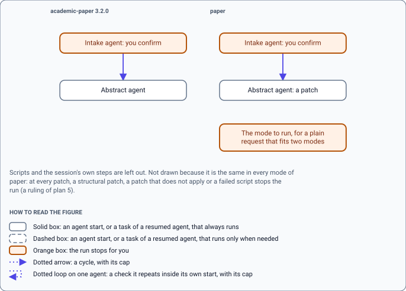

# Coverage of the academic skills

This list says what happens to every file of the four academic skills installed in research-hub when Ordo's own writing skills replace them (roadmap entries 3 to 16). Each file is marked with the new skill that must cover what it does, the new skill that will cover it later, or `drop`, and the reason says what the file holds that decides it. A new skill's plan starts from the rows that name it.

The files are those in `research-hub/.agents/skills/` of the skills `academic-paper`, `academic-paper-reviewer`, `academic-pipeline` and `deep-research`, installed from `imbad0202/academic-research-skills`. Their `computedHash` values in research-hub's `skills-lock.json` when this list was written:

- `academic-paper`: `54cd6f3549239f10821d688f0b2894c165b8ee3162fb235711f1223e08973f8b`
- `academic-paper-reviewer`: `6940aa353c2ad3ff52082a33487e4a98fd6813aed6d25929f4f82a499c21b9fd`
- `academic-pipeline`: `04dea9ef49eae79fd2f4ce6a04765f15ee7afe32b79a9bdcb72cf7cfc54fea38`
- `deep-research`: `e20235bd776f36c9e8cceb38fe71713ad008695d92e91f7869a3c6c8cba964ad`

The marks:

- `rebuild: <skill>`: the new skill that roadmap entry builds must cover what the file does before that entry's gate. The one exception is a part deferred to a later entry, as the `rebuild later` line says. Once the skill is built, the reason also names in backticks the new skill's file that now holds the listed file's content. It names that file by its repository path, such as `skills/paper/SKILL.md`. Paths of the source skill may stay beside it.
- `rebuild later: <skill>`: the file belongs to that new skill, but the skill's first gate does not need it. A part of a `rebuild: <skill>` file that the skill's first gate does not need may go to a later entry. The reason names the `rebuild later: <skill>` file of the same skill that carries it, so that entry builds the part when it builds that file.
- `drop`: no new skill needs the file; the reason says why, and where a rule in it is kept elsewhere, it names the file that keeps it.

A part goes to the first roadmap entry whose gate needs it, and a skill that reads a part from another skill's files names an entry that is built before its own.

Every file was read in full before it was marked. A file whose content splits across skills is marked for the skill that takes most of it, and the reason names a destination, or a drop with its reason, for every part the file holds. A rewrite of a reason keeps every destination the old reason named, unless it names the part's new one.

Each claim in a reason is one the file's lines make, with the file's own numbers and conditions: a reason does not round a number, turn a condition into a rule, or name a feature the file does not hold.

The check, run from the repository root over the four skills, exits 0 only when every file of the named skills is listed exactly once with a valid mark and a reason:

```sh
python3 utils/check_coverage.py docs/academic-coverage.md /Users/axelfaes/workspace/research-hub/.agents/skills academic-paper academic-paper-reviewer academic-pipeline deep-research
```

## New skills

| Skill | Roadmap entry |
|---|---|
| writing | 3 |
| code-comments | 4 |
| paper | 5 |
| paper-review | 6 |
| rebuttal | 7 |
| grant | 8 |
| idea | 10 |
| scaffold | 11 |
| project-docs | 12 |
| researcher | 13 |
| submit-manuscript | 14 |
| submit-grant | 15 |

## paper against academic-paper

Each mode of `paper` beside the same mode of academic-paper 3.2.0, drawn by `docs/figures/academic-paper-comparison/gen_comparison.py`. The simple view draws the agent starts, the stops and the cycles, and the detailed view draws every step, script and stop. Two rulings hold in every mode and are not drawn: an unfinished run is offered for continuing with its finished steps skipped, and intake of full and outline-only offers an earlier lit-review's review and `.bib` and an earlier outline-only's approved outline, which full then skips.

### full

![The full mode, simple view. academic-paper 3.2.0: Intake agent: you confirm (stop); Literature strategist, unless you give your own sources (agent, only when needed); You review the sources, optional (stop); Structure architect; Outline approval (stop); Argument builder; Draft writer, 2 calls; Visualization, with data (agent, only when needed); Citation compliance; Abstract agent; Peer reviewer, 2 calls; Draft writer: the whole draft again; RAISE compliance agent; You decide (stop); Formatter; Output refused (stop). paper: Intake agent: you confirm (stop); Literature strategist, unless you skip it; each source confirmed by a live lookup (agent, only when needed); Literature strategist, theme run: search theme 1 (agent, only when needed); Literature strategist, theme runs: each other search theme, all at once (agent, only when needed); Literature strategist, merge run, after the theme runs: removes the duplicates, assesses the sources the theme runs hand on, searches where the search themes meet, runs the quality gates, writes the one review (agent, only when needed); You review the sources, optional (stop); Planner; A research question the materials do not answer, when a part has no result (stop); Literature strategist: the sections with no source (agent, only when needed); Planner: assigns what was found (agent, only when needed); Planner, fresh: rewrites each argument with two or more weak-argument signs (agent, only when needed); Outline approval: each rewritten argument before and after (stop); Draft writer; Draft writer once more: the model identifier, when the model list gave none or the served one differs (agent, only when needed); Visualization, with data (agent, only when needed); Citation compliance; Citation compliance once more, when a check fails (agent, only when needed); A claim the run cannot support, or a reference that cannot be confirmed (stop); The citation style to confirm, when more than half the entries fail the same check (stop); Peer reviewer; Draft writer: a patch; Citation compliance for each later patch with a cited sentence: those sentences only (agent, only when needed); The draft review rejects the draft: each Critical issue classed, a roadmap (stop); The draft review does not pass: no answer recommended (stop); Draft writer: reference fix (agent, only when needed); A reference that cannot be confirmed (stop); Draft writer: compile fix (agent, only when needed); /writing: 4 agents, unless you said no at intake (agent, only when needed); End: the final message, with the /writing report and your reply, optional; Draft writer: applies what you pick (agent, only when needed); Citation compliance: the sentences of the findings pass (agent, only when needed); Peer reviewer: reads the findings pass (agent, only when needed); Draft writer: compile fix (agent, only when needed); Draft writer: the anonymous copy, for a double-blind venue (agent, only when needed); Formatter: the DOCX and Markdown targets you named (agent, only when needed).](figures/academic-paper-comparison/full-simple.svg)

![The full mode, detailed view. academic-paper 3.2.0: Phase 0 Intake: configuration record, citation verification: mark only or strict (stop); you skip Phase 1, giving your own sources? (decision); Phase 1 Literature strategist: screens your sources, searches for what they miss, unless you say your sources only; You review the sources: add or remove, optional (stop); Phase 2 Structure architect: outline and evidence map; Outline approval (stop); Phase 3 Argument builder; Phase 4 Draft writer: 4a pre-commitment, 4b draft and self-scores; Visualization, when there are quantitative results: figure code and LaTeX inclusion code; Phase aborted: you decide (stop); Phase 5a Citation compliance: corrects format and DOIs, flags a wrong source, stops on a claim not in its source; Phase 5b Abstract agent, in parallel; Phase 6 Peer reviewer, round 1: 6a scoring plan, 6b scores and verdict; You decide (stop); Draft writer: revises, a full draft again; Peer reviewer, round 2: the revised sections; RAISE compliance check, warnings only; Phase 7 Formatter: adds the AI disclosure and limitations if missing, places the figures, converts, compiles with tectonic or xelatex; Final checklist: content, format, required elements, DOIs; compile errors fixed, warnings accepted; Hard gate: a citation unverified, fabricated or unsupported, or blocked under strict? (decision); Output refused: you fix it (stop); Output package. paper, as ruled: Intake agent: config.md, the interview (D24); skip the search? DOI checking (O), venue policy (W), claims not to make (AI2), main.tex to replace (AD4), a file in words (AQ), research report, question, type (AV1, AV3, AV15) (stop); you skip the search? (J) (ruled); Session: the search themes, clusters of the method areas, each with its scope and target range, in config.md Decisions (The academic-paper strategist) (decision); Literature strategist, theme run: search theme 1, review-theme-1.md and refs-theme-1.bib; each included source confirmed by a live lookup, an unconfirmed one excluded and listed (The academic-paper strategist) (ruled, only when needed); Literature strategist, theme runs: each other search theme, all at once (The academic-paper strategist) (ruled, only when needed); Literature strategist, merge run, fresh: the duplicates removed, each source the theme runs hand on assessed, the searches where the search themes meet, the report over the merged set, the gates computed; review.md, refs.bib (CA) (ruled, only when needed); Literature strategist: screens your sources, searches for what they miss; a list over 50 entries shows its first 20 and last 5 (J, AV16) (ruled, only when needed); The strategist, one search theme: each included source confirmed by a live lookup, an unconfirmed one excluded and listed (The academic-paper strategist) (ruled); You review the sources: add or remove, optional (J) (stop); Planner: outline and evidence map, argument map; one role for structure architect and argument builder (D43); the structure checked against the question and the materials (AV18) (ruled); A research question the materials do not answer: the part, the files and lines, what would answer it, three options (BI) (stop); Literature strategist, resumed or fresh: the sections that need literature and have no source (AD1, BR); the merge run's after theme runs (The academic-paper strategist) (ruled); Planner again: assigns what was found (AD1) (ruled); Planner, fresh: rewrites each argument with two or more weak-argument signs (The simulation in step 5.F) (ruled); Outline approval: each rewritten argument before and after (The simulation in step 5.F) (stop); Planner: asks what is wrong with the structure, writes 2 alternatives; your own structure is followed as user-customized (AD2) (ruled); Draft writer: first draft, abstract in the venue's form, six statements, figure places (S), model named (N), claims list and results (AV7, BH), cover letter (AV8), no self-scores (D43, D45), prose standard (AJ, AW) (ruled); Draft writer once more: the model identifier, when the list gave none (N) or the served one differs (ruled); Visualization, when the materials hold data, beside the writer (D43): figures and their LaTeX, placed as its own patch (S) (ruled); Script: cite-keys, check-urls (AF) (script); Citation compliance agent, after the draft and before round 1: reads each cited source, judges every claim, checks the claims not to make and the intended claims (AF, AI2, AV7, The simulation in step 5.F) (ruled); A claim the run cannot support: every claim not held in one list, a source not read apart (AF, The simulation in step 5.F) (stop); The citation style to confirm: more than half the entries fail the same check (AV14) (stop); Script: cite-keys, check-urls, quote-check (AF) (script); Citation compliance agent again, fresh, once (AF) (ruled); Peer reviewer, round 1: fixed criteria, no scoring plan, reads the citation report (D45, AF) (ruled); The draft review does not pass, no answer recommended: the root cause and its estimate; revise by hand, a lower venue, accept, an expanded revision by root cause, or end (AD3, BR) (stop); The draft review rejects the draft: each Critical issue fixable, structural or fundamental, a roadmap; nothing revised before you confirm (BR) (stop); Draft writer: round 1 issues, a patch (C) (ruled); Citation compliance agent, fresh: the cited sentences of the patch only, citation-report-<nn>.md (BI) (ruled); Peer reviewer, round 2: also checks each number against its result file and row, and each description of the data handling (D45, BH) (ruled); Script: reference checks (script); Draft writer: reference-fix, once (K) (ruled); Script: reference checks again, failures left named (K) (script); A reference that cannot be confirmed (O) (stop); Session: compile in a copy, no formatter; the engine is the first that applies of a % !TEX program line, the class table, the venue's template, XeLaTeX (M, AV11) (4.A R2-6) (ruled); Session: the PDF of the compile copied to main.pdf beside main.tex (The simulation in step 5.F) (ruled); Draft writer: compile-fix, once (M) (ruled); Session: compile once more, the rest named (M) (ruled); /writing review: 4 agents, unless you said no at intake (D46, 5.C (2)) (ruled, only when needed); End: the final message with the numbered report, the sources only a preprint server or no index matched, and a verdict that was not Accept (D46, AG) (ruled); Draft writer: applies the findings (D46) (ruled); Citation compliance agent, fresh: the cited sentences of the findings pass (BI) (ruled); Peer reviewer, fresh: reads the findings pass, its numbers and its descriptions of the data; an item goes to the writer once, then the compile (BI) (ruled); Draft writer: the anonymous copy, when the venue is double-blind (AV9) (ruled); Formatter: the DOCX and Markdown targets of Target formats, after the last compile (The simulation in step 5.F) (ruled, only when needed); At every patch: a structural patch, a patch that does not apply (retry as often as you ask, write it again in full, or leave it (BR)), a script failed (C) (stop).](figures/academic-paper-comparison/full-detailed.svg)

### revision

![The revision mode, simple view. academic-paper 3.2.0: Peer reviewer: the comments as a roadmap; Draft writer: a patch; You decide (stop); Citation compliance; Revised draft, the rest as limitations. paper: Intake agent: you confirm (stop); Peer reviewer: the instructions as items, or, with none, a review of the manuscript; A research question the materials do not answer, when an item names a part (stop); You approve the items, with no instructions (stop); Literature strategist, for a new reference (agent, only when needed); Visualization, for a figure (agent, only when needed); Draft writer: a patch per item; Citation compliance; Citation compliance once more, when a check fails (agent, only when needed); A claim the run cannot support, or a reference that cannot be confirmed (stop); The citation style to confirm, when more than half the entries fail the same check (stop); Peer reviewer: reading; Draft writer: one pass; Citation compliance for each later patch with a cited sentence: those sentences only (agent, only when needed); Draft writer: reference fix (agent, only when needed); A reference that cannot be confirmed (stop); Draft writer: compile fix (agent, only when needed); /writing: 4 agents, unless you said no at intake (agent, only when needed); End: the final message, with the /writing report and your reply, optional; Draft writer: applies what you pick (agent, only when needed); Citation compliance: the sentences of the findings pass (agent, only when needed); Peer reviewer: reads the findings pass (agent, only when needed); Draft writer: compile fix (agent, only when needed); Draft writer: the anonymous copy, for a double-blind venue (agent, only when needed).](figures/academic-paper-comparison/revision-simple.svg)

![The revision mode, detailed view. academic-paper 3.2.0: Peer reviewer: the comments as a revision roadmap; Script: anchorize the draft (script); Draft writer: a patch, never a full draft; Script: apply the patch to a new file (script); You decide: retry, full re-emission or abort (stop); You acknowledge it, or the patch is narrowed (stop); You confirm a full re-emission (stop); Citation compliance on the revised draft; Revised draft, apply report, revision log. paper, as ruled: Intake agent: config.md, the run's permissions, DOI checking, the instructions (D24, Stops of paper, O, AA), the claims not to make (AI2), a file given in words (AQ), the evidence profile (AV2) (stop); Peer reviewer: the instructions as items.md; Peer reviewer: reviews the manuscript with full mode's draft-review criteria, its issues as items.md (AA) (ruled); A research question the materials do not answer: the part, the files and lines, what would answer it, three options (BI) (stop); You approve the items: drop or add, no patch before (AA) (stop); Literature strategist: a .bib patch for the items that need a new reference (Stops of paper); each included source confirmed by a live lookup, an unconfirmed one excluded and listed (The academic-paper strategist) (ruled); Visualization, within the permission; the script files it changes outside the run folder are hashed before and after (Stops of paper) (ruled); Script: anchorize the files (script); Draft writer: a patch per item, a revision log with its statuses; each number it writes has its result file and row in the claims list (AD6, BH) (ruled); Script: apply the patch (script); A patch that does not apply: retry as often as you ask, write it again in full, or leave it (BR) (stop); A structural patch (stop); Citation compliance agent, after the patches: reads each cited source, checks the claims not to make, lists the claims off the list of intended claims (AF, AI2, AV7) (ruled); A claim the run cannot support: every claim not held in one list, a source not read apart (AF, The simulation in step 5.F) (stop); The citation style to confirm: more than half the entries fail the same check (AV14) (stop); Script: cite-keys, check-urls, quote-check, failures are items of reading 1 (D49, K, AF) (ruled); Citation compliance agent again, fresh, once (AF) (ruled); Peer reviewer: reading 1, reads the citation report, checks each number against its result file and row, and each description of the data handling (D49, AF, BH) (ruled); Draft writer: the one pass (D49) (ruled); Citation compliance agent, fresh: the cited sentences of the patch only, citation-report-<nn>.md (BI) (ruled); Script: reference checks, failures are items of reading 2 (K) (ruled); Peer reviewer: reading 2 (D49) (ruled); Draft writer: reference-fix, once (K) (ruled); Script: reference checks again, failures left named (K) (script); A reference that cannot be confirmed (O) (stop); Session: compile in a copy; the engine is the first that applies of a % !TEX program line, the class table, the venue's template, XeLaTeX (D46, AV11) (4.A R2-6) (ruled); Session: the PDF of the compile copied to <main>.pdf beside the main .tex (The simulation in step 5.F) (ruled); Draft writer: compile-fix, once (M) (ruled); Session: compile once more, the rest named (M) (ruled); /writing review: 4 agents, unless you said no at intake (D46, 5.C (2)) (ruled, only when needed); End: the final message with the numbered report, the sources only a preprint server or no index matched, and the files the figure script changed (D46, AG) (ruled); Draft writer: applies the findings (D46) (ruled); Citation compliance agent, fresh: the cited sentences of the findings pass (BI) (ruled); Peer reviewer, fresh: reads the findings pass, its numbers and its descriptions of the data; an item goes to the writer once, then the compile (BI) (ruled); Draft writer: the anonymous copy, when the venue is double-blind (AV9) (ruled); At every patch: a script failed (stop).](figures/academic-paper-comparison/revision-detailed.svg)

### lit-review

![The lit-review mode, simple view. academic-paper 3.2.0: Intake agent: you confirm (stop); Literature strategist; You review the sources, optional (stop). paper: Intake agent: you confirm (stop); Literature strategist: each source confirmed by a live lookup (agent, only when needed); Literature strategist, theme run: search theme 1 (agent, only when needed); Literature strategist, theme runs: each other search theme, all at once (agent, only when needed); Session: each report read for work left undone, a theme run that left work undone sent back once (question); Script: each theme run's DOIs and arXiv IDs resolved (script); Literature strategist, resumed with the identifier check: titles resolved, strict: a failing identifier corrected or removed (agent, only when needed); Literature strategist, merge run, after the theme runs: removes the duplicates, assesses the sources the theme runs hand on, searches where the search themes meet, runs the quality gates, writes the one review (agent, only when needed); Session: the strategist's report read for work left undone, a merge run that left work undone sent back once (question); Script: every entry resolved, no identifier or title under two keys, the cited keys equal to the .bib's (script); Session: the exclusions read; one on a failed lookup is work left undone, a failure or such an exclusion sent back once (question); You review the sources, optional (stop); Script: each corrected or added entry's DOI or arXiv ID resolved again (script); A reference that cannot be confirmed, strict (stop); Formatter: each target other than Markdown, the review's issues back to the strategist (agent, only when needed).](figures/academic-paper-comparison/lit-review-simple.svg)

![The lit-review mode, detailed view. academic-paper 3.2.0: Intake, citation verification: mark only or strict (stop); Literature strategist; You review the sources: add or remove, optional (stop); Annotated bibliography, literature matrix, synthesis. paper, as ruled: Intake agent: the draft and its questions, then config.md, DOI checking, the research question the run needs (D24, O, AD11, AV15); a research report and its bibliography (AV1); the profile (AV2); a file in words (AQ) (stop); Session: the search themes, clusters of the method areas, each with its scope and target range, in config.md Decisions (The academic-paper strategist) (decision); Literature strategist, theme run: search theme 1, review-theme-1.md and refs-theme-1.bib; each included source confirmed by a live lookup, an unconfirmed one excluded and listed (The academic-paper strategist) (ruled, only when needed); Literature strategist, theme runs: each other search theme, all at once (The academic-paper strategist) (ruled, only when needed); Literature strategist, merge run, fresh: the duplicates removed, each source the theme runs hand on assessed, the searches where the search themes meet, the report over the merged set, the gates computed; review.md, refs.bib (CA) (ruled, only when needed); Literature strategist: review.md, refs.bib; a list over 50 entries shows its first 20 and last 5; it does not start without a research question (D2, AD11, AV15, AV16) (ruled, only when needed); The strategist, one search theme: each included source confirmed by a live lookup, an unconfirmed one excluded and listed (The academic-paper strategist) (ruled); Session: each theme run's report read as it ends, or the one strategist's, for work of its prompt or its page left undone (The academic-paper strategist) (decision), a theme run that left work undone sent back once; Script, run by the session: lookup.py resolve on each theme run's .bib as it ends, or on refs.bib for one theme, a proceedings page read for an entry with neither, into checks.md (The academic-paper strategist) (script); Literature strategist, resumed with checks.md: the differing titles resolved; strict: a failing identifier corrected or removed, once (O) (The academic-paper strategist) (ruled); Session: the merge run's report read, or the one strategist's, for sources or leads not assessed and items of its prompt not done (The academic-paper strategist) (decision), a merge run that left work undone sent back once; Script, run by the session: lookup.py resolve on every entry of refs.bib, no identifier or title under two keys, the cited keys equal to the .bib's, into checks.md (The academic-paper strategist) (script); Session: the exclusions read; one made on a failed lookup is work left undone (The academic-paper strategist) (decision), a failure or such an exclusion sent back once; You review the sources: add or remove, optional (J) (stop); Script, run by the session: lookup.py resolve again on each corrected or added entry's DOI or arXiv ID, into checks.md (O) (The academic-paper strategist) (script); A reference that cannot be confirmed (O) (stop); Formatter: each target of Target formats other than Markdown, from review.md with refs.bib as given; the review's issues back to the strategist, then the targets again (The academic-paper strategist) (ruled, only when needed); End; At every patch: a structural patch, a patch that does not apply (retry as often as you ask, write it again in full, or leave it (BR)), a script failed (C) (stop).](figures/academic-paper-comparison/lit-review-detailed.svg)

### outline-only

![The outline-only mode, simple view. academic-paper 3.2.0: Intake agent: you confirm (stop); Literature strategist; You review the sources, optional (stop); Structure architect; Outline approval (stop). paper: Intake agent: you confirm (stop); Literature strategist: each source confirmed by a live lookup (agent, only when needed); Literature strategist, theme run: search theme 1 (agent, only when needed); Literature strategist, theme runs: each other search theme, all at once (agent, only when needed); Literature strategist, merge run, after the theme runs: removes the duplicates, assesses the sources the theme runs hand on, searches where the search themes meet, runs the quality gates, writes the one review (agent, only when needed); You review the sources, optional (stop); Planner: outline and argument map; Literature strategist: the sections with no source (agent, only when needed); Planner: assigns what was found (agent, only when needed); Outline approval (stop).](figures/academic-paper-comparison/outline-only-simple.svg)

![The outline-only mode, detailed view. academic-paper 3.2.0: Intake, citation verification: mark only or strict (stop); Literature strategist; You review the sources: add or remove, optional (stop); Structure architect: outline and evidence map; Outline approval (stop); Outline, evidence map, word count per section. paper, as ruled: Intake agent: config.md (D24); the research question in full, a research report and its bibliography read (AV1, AV15), the type by the selection table (AV3); a file given in words found by search (AQ) (stop); Session: the search themes, clusters of the method areas, each with its scope and target range, in config.md Decisions (The academic-paper strategist) (decision); Literature strategist, theme run: search theme 1, review-theme-1.md and refs-theme-1.bib; each included source confirmed by a live lookup, an unconfirmed one excluded and listed (The academic-paper strategist) (ruled, only when needed); Literature strategist, theme runs: each other search theme, all at once (The academic-paper strategist) (ruled, only when needed); Literature strategist, merge run, fresh: the duplicates removed, each source the theme runs hand on assessed, the searches where the search themes meet, the report over the merged set, the gates computed; review.md, refs.bib (CA) (ruled, only when needed); Literature strategist, for one search theme; the search always runs, and it does not start without a research question (J, AV15) (ruled, only when needed); The strategist, one search theme: each included source confirmed by a live lookup, an unconfirmed one excluded and listed (The academic-paper strategist) (ruled); You review the sources: add or remove, optional (J) (stop); Planner: outline and evidence map, argument map with its weak-argument signs (D43, T); the structure checked against the question and the materials (AV18) (ruled); Literature strategist, resumed or fresh: the sections that need literature and have no source (AD1, BR); the merge run's after theme runs (The academic-paper strategist) (ruled); Planner again: assigns what was found (AD1) (ruled); Outline approval (stop); Planner: asks what is wrong with the structure, writes 2 alternatives; your own structure is followed as user-customized (AD2) (ruled); Outline, evidence map and argument map (T) (ruled).](figures/academic-paper-comparison/outline-only-detailed.svg)

### abstract-only



![The abstract-only mode, detailed view. academic-paper 3.2.0: Intake, citation verification: mark only or strict (stop); Abstract agent; Abstract and keywords. paper, as ruled: Intake agent: config.md, the paper type, the language and the claims not to make (D24, AD12, AI2); a file given in words found by search (AQ) (stop); Session: grep for the file that holds the abstract environment, since the patch must name that file (C) (script); Draft writer, in place of the abstract agent: abstract and keywords, one patch, its parts and lengths by paper type, its own text checked against the prose standard (T, AJ, AV18) (ruled); Abstract and keywords; At every patch: a structural patch, a patch that does not apply, a script failed (C) (stop).](figures/academic-paper-comparison/abstract-only-detailed.svg)

### citation-check


![The citation-check mode, detailed view. academic-paper 3.2.0: Citation compliance agent, one pass: cross-check, format, DOI, retractions; each issue (decision); Corrected, logged; Flagged for your review; Revised wording suggested; STOP: possible fabrication (stop); Removed, or kept with a note; Citation audit report. paper, as ruled: Intake agent: config.md, DOI checking strict or mark only (D24, O), the authors' earlier papers (AD8), the claims not to make (AI2); a file given in words found by search (AQ) (stop); Script: cite-keys, check-urls (D15, D17) (script); Citation compliance agent: fetches each source and reads the passage each claim cites (D50, D22); retraction notices from lookup.py (AD7); clinical rows (AH); versions of one work (AK); claims list (AV7) (ruled); Passages that closely repeat an earlier paper: reuse of results is flagged, a plagiarism tool is suggested (AD8) (ruled); each issue (decision); Corrected by a patch, logged; Flagged for your review; Revised wording suggested, no patch; A claim the run cannot support (stop); Replaced by a candidate whose passage holds the claim, as a patch; flagged for you when none does (X) (ruled); A reference that cannot be confirmed (stop); The citation style to confirm: more than half the entries fail the same check (AV14) (stop); Script: cite-keys, check-urls, quote-check (D50, D22) (script); Citation compliance agent again, fresh, once (L) (ruled); Script: the three checks again, failures left named (L) (script); Citation report, checks.md; At every patch: a structural patch, a patch that does not apply, a script failed (C) (stop).](figures/academic-paper-comparison/citation-check-detailed.svg)

### disclosure

![The disclosure mode, simple view. academic-paper 3.2.0: You name the venue, and paste the policy of a venue it does not know (stop); You confirm each uncertain kind of AI use (stop); Formatter (agent, only when needed). paper: Intake agent: the venue or the policy anchor, the policy of a venue not listed, the kinds of AI use the records leave uncertain; you confirm (stop); Draft writer: the statements; Draft writer once more: the model identifier, when the model list gave none or the served one differs (agent, only when needed).](figures/academic-paper-comparison/disclosure-simple.svg)

![The disclosure mode, detailed view. academic-paper 3.2.0: a venue or a policy anchor given? (decision); You name one (stop); venue in the policy database? (decision); Anchor table lookup; Halt: you paste the venue's policy (stop); Each kind of AI use marked used, not used or uncertain; You confirm it (stop); Session metadata: the model of this run; Disclosure paragraph: Claude, the model's name, (Anthropic), in the venue's voice and phrasing; Paragraph and placement. paper, as ruled: Intake agent: config.md, the venue or the policy anchor (AV12), the kinds of AI use the records of earlier runs leave uncertain, each other kind pre-marked; you confirm (D24, AD10); a file in words (AQ) (stop); the venue listed? (decision); Session: the opus identifier of the model list, such as claude-opus-5-5, else the first agent's served model (N, 5.C (6)); the draft writer's served identifier when it differs (ruled); Draft writer: the statements as a patch, disclosure.md; the disclosure names that model (D43, D47) (ruled); Draft writer once more: the model identifier, when the list gave none (N) or the served one differs (ruled); Statements and placement; At every patch: a structural patch, a patch that does not apply, a script failed (C) (stop).](figures/academic-paper-comparison/disclosure-detailed.svg)

### plan

![The plan mode, simple view. academic-paper 3.2.0: Intake agent: 3 questions, you confirm (stop); Socratic mentor, chapter by chapter; Structure architect: the outline; Socratic mentor and argument builder: the stress test; Chapter plan and INSIGHT collection. paper: Intake agent: you confirm (stop); Socratic mentor: given each answer, resumed or started fresh; The mentor's question: each answer; offers after 8 rounds on a chapter and 30 in all (stop); Planner: the outline from the chapter summaries; Mentor, Step 2.5: contribution sharpening, one round or more; Planner: evaluates each stress-test answer; Planner: the chapter plan; The plan's handoff (stop).](figures/academic-paper-comparison/plan-simple.svg)

![The plan mode, detailed view. academic-paper 3.2.0: Intake: the 3-question simplified interview (stop); Step 0 readiness check: materials and the research question; a missing foundation is sent to deep-research first; Step 1 thesis: INSIGHT thesis_statement; Step 2 chapters, six in order, at least 2 rounds each; a chapter summary after each; Structure architect: the outline from all chapter summaries; Step 2.5 contribution sharpening, at least 1 round; INSIGHT contribution_claim; Step 3 stress test: socratic mentor and argument builder probe each sub-argument; Chapter plan and INSIGHT collection. paper, as ruled: Intake agent: config.md (D24); the plan-mode interview of the topic, the materials in hand and the structure preference (stop); Socratic mentor, given each answer, resumed or started fresh; Step 0 refers a missing foundation to /paper lit-review and idea (4.A D5); checkpoint.md after each round (AY) (ruled); The mentor's question: each round is a stop; its offers are to skip a chapter, switch to outline-only or pause (4.A D1) (stop); Planner, a fresh start when the mentor ends with next: outline; the outline and the argument map from the chapter summaries (AY) (4.A D16) (ruled); Socratic mentor, Step 2.5: contribution sharpening, three questions on the chapter summaries, one round or more (4.A R2-7) (ruled); Planner, a fresh start for each answer: sub-arguments rated Strong, Moderate or Weak into stress-test.md (4.A D6) (ruled); Planner, a fresh start: chapter-plan.md with the plan-to-draft gate (4.A D6) (ruled); The plan's handoff: the mentor's message and its cross-chapter observation beside the chapter plan; full mode only when the gate holds (4.A D3) (4.A R2-27) (stop); Chapter plan and INSIGHT collection.](figures/academic-paper-comparison/plan-detailed.svg)

### format-convert


![The format-convert mode, detailed view. academic-paper 3.2.0: Phase 7 Formatter: LaTeX, DOCX through Pandoc, PDF or Markdown; journal formatting; citations between APA 7, Chicago, MLA, IEEE and Vancouver; Hard gate: an unresolved citation-provenance marker in the input? (decision); Output refused (stop); Final checklist: content, format, required elements; word count within 1 percent; compile errors fixed, warnings accepted; Formatted document. paper, as ruled: Intake agent: config.md (D24); the targets, the citation style, the venue and its limits, the format profile, the cover letter; a .md, .docx or .bib found by search (AQ) (4.A R2-20) (stop); Session: pandoc makes the .tex of a .md or .docx in the manuscript's folder with a relative media folder, never over a file; a .docx reaches no PDF (4.A D10) (4.A R1-21) (script); Session: copies the folder to convert/ before any patch; when the citation style stays, compiles it for the numbers of references and citations, whether or not the .tex names a .bib (4.A R1-23) (4.A R2-1) (script); Formatter, first start: the format-convert patch, and the format-convert-copy patch too when the style stays; format-report.md, refs.bib, the cover letter (AY) (4.A R1-23) (4.A R2-9) (4.A R2-33) (ruled); Formatter, same start: a missing required element gets a placeholder in the .tex, a missing DOI only a line in the report; the AI disclosure stays with the draft writer (AD9) (4.A R1-8) (ruled); Session: applies the format-convert patches to the manuscript only for latex, another citation style or a venue, else to pdf/; then cite-keys and check-urls (C) (4.A R1-26) (script); A change of the citation style with a DOCX or Markdown target: the session applies the patch to convert/ and compiles it, and the formatter starts again as a fresh agent for the conversion patch in the new style (4.A R2-9) (ruled); Session: latexmk makes the PDF in pdf/ and copies it beside the .tex (AY) (script); Session: applies the copy patches to convert/ and draws each figure to a PNG, kept beside the Markdown (4.A R1-22) (4.A R2-8) (script); Session: reference_docx.py writes the reference .docx when none is held, pandoc makes DOCX and Markdown with -s (4.A R1-24) (4.A R2-12) (script); Session: the counts of headings, figures, tables, rows, columns, cite commands, entries and words of each output, no threshold (4.A item 6) (4.A R2-21) (4.A R2-23) (script); Session: the figure paths and the abstract's first words (4.A item 6) (4.A R2-23) (script); Session: appends the commands it ran to format-report.md (4.A R2-26) (script); Formatted documents and the report; A .bib given: no formatter and none of the steps above; latex and bibtex with the style's .bst, or a CSL file, make its reference list as <name>-<style>.md and .docx (4.A R2-20) (script); At every patch: a structural patch, a patch that does not apply, a script failed (C) (stop).](figures/academic-paper-comparison/format-convert-detailed.svg)

### The modes academic-paper has and paper does not


### academic-pipeline and where its stages go

![academic-pipeline: the 10 stages, and where each stage goes now. The stages: 1 Research: deep-research; 2 Write: academic-paper, plan or full; 2.5 Integrity check; 3 Review: academic-paper-reviewer; Back to stage 2, or end; 4 Revise: academic-paper revision; 3' Re-review; 4' Re-revise, no review after; 4.5 Final integrity check, zero issues to pass; 5 Finalize: DOCX, LaTeX, PDF; 6 Process summary. Where each goes now: 1 Research goes to researcher, entry 13 (not built yet); 2 Write goes to paper plan and paper full; 2.5 Integrity check goes to researcher, entry 13; 3 Review goes to paper-review, entry 6 (not built yet); 4, 3', 4' Revise and re-review go to paper revision; 4.5 Final integrity check goes to researcher, entry 13; 5 Finalize goes to paper format-convert; 6 Process summary goes to none. The integrity and ethics checks run in researcher, once on paper's finished draft and once after its revision.](figures/academic-paper-comparison/academic-pipeline.svg)

## academic-paper

| File | Mark | Reason |
|---|---|---|
| `SKILL.md` | rebuild: paper | The paper skill takes full mode (approved outline, two revision rounds, no orphan citations, a closing check of six statements, limitations and the formatter's pre-output checklist), held in `skills/paper/SKILL.md` and `skills/paper/references/peer-reviewer.md`. `rebuttal` takes revision-coach and rebuttal-audit, `paper` takes lit-review with `agents/literature_strategist_agent.md`, held in `skills/paper/SKILL.md` and `skills/paper/references/literature-strategist.md`, and `paper` takes plan mode with `references/plan_mode_protocol.md` and `agents/socratic_mentor_agent.md`, held in `skills/paper/SKILL.md` and `skills/paper/references/socratic-mentor.md`, and format conversion with `agents/formatter_agent.md`, held in `skills/paper/SKILL.md` and `skills/paper/references/formatter.md`. A plain request picks the mode by the table of request kinds, held in `skills/paper/references/modes.md`. The paper skill leaves out the zh-TW triggers, the higher-education defaults and the generator-evaluator contract. |
| `agents/abstract_bilingual_agent.md` | rebuild: paper | Language-neutral rules ask for five parts, 150 to 300 words, five to seven keywords outside the title, no citations and defined abbreviations, held in `skills/paper/references/draft-writer.md`. Entry 5 drafts every abstract with them, held in `skills/paper/SKILL.md`, leaving out the zh-TW abstract. The abstract takes the form the venue's template or limits state, the structured form for a journal in a medical or clinical discipline with none stated, and at most 300 words when no limit is stated, and a manuscript of the class `elsarticle` takes 3 to 5 highlights of at most 85 characters, held in `skills/paper/references/draft-writer.md` ("Which abstract", "Highlights") and `skills/paper/references/latex-template.md`. It also takes the abstract-only protections of `deep-research/agents/report_compiler_agent.md`: a word budget kept below the hard cap, protected hedging phrases kept, and explicit time bounds in a reflexivity statement, held in `skills/paper/references/draft-writer.md`. An abstract never claims an audit that did not run, held in `skills/paper/references/draft-writer.md`. The draft writer writes the abstract, so the abstract agent is not a role of the paper skill. |
| `agents/argument_builder_agent.md` | rebuild: paper | A thesis rests on three to five claim-evidence-reasoning chains with counter-arguments and rebuttals, and two weak-argument signs stop drafting and start a fresh planner that rewrites the argument before the outline's approval, which shows it before and after, as the source's "return to argument_builder for strengthening" does, held in `skills/paper/SKILL.md`, full item 6, and `skills/paper/references/planner.md` and `skills/paper/SKILL.md`, where the planner writes the argument map beside the outline. The plan-mode stress test, ratings and chapter plan are held in `skills/paper/references/planner.md` ("Plan mode"), through `agents/socratic_mentor_agent.md`. |
| `agents/citation_compliance_agent.md` | rebuild: paper | Citations and references are checked both ways and for DOI form, self-citation, age and retractions, held in `skills/paper/references/citation-compliance.md`. The agent judges every claim, and the session then raises one stop that lists each claim a read source does not hold, with each source that could not be read shown apart as "not read" with the addresses tried, held in `skills/paper/references/citation-compliance.md` and `skills/paper/SKILL.md`, Steps 12. This is a deviation from academic-paper, whose `agents/citation_compliance_agent.md` stops the check at the first claim not in its source ("Major (claim not in source) -> STOP"), recorded in ADR 0036: every claim is judged, and the user rules on all of them at once. A retracted source is replaced by a patch when a candidate from a search holds the claim, and is flagged for the user otherwise. A source cited to discuss its retraction is noted as such. A partial retraction and an expression of concern are noted or flagged as the source has them, held in `skills/paper/references/citation-compliance.md`. The agent runs in full, revision and citation-check mode, held in `skills/paper/SKILL.md`. The paper skill's `\cite`-against-`.bib` and DOI checks come from here, held in `skills/paper/SKILL.md`. It corrects a format error itself instead of only reporting it, except when more than half the cited entries fail the same check. The agent then reports the pattern and writes no patch in that start. The run stops to ask the user to confirm the citation style, and a second start does the work again, held in `skills/paper/references/citation-compliance.md` ("A format error in most entries") and `skills/paper/SKILL.md`. In full and revision mode a fresh start checks the cited sentences of each later patch that adds or changes one, and only those, and writes a `citation-report-<nn>.md` for it, held in `skills/paper/references/citation-compliance.md` ("The incremental check") and `skills/paper/SKILL.md`. An index line that says "left out" confirms nothing, and an entry whose year or venue only a left-out index could have given is looked up again by its DOI or arXiv ID, held in `skills/paper/references/citation-compliance.md` ("Looking a reference up"). It also compares what the draft claims with the list the draft writer wrote before the first text. It flags a claim that is on no list and an intended claim the draft does not make, held in `skills/paper/references/citation-compliance.md` ("Claims against the list"). It reads each cited source's text, and each earlier paper of the authors, from the first way that gives the full text. The ways are the file `lookup.py fetch` writes, PMC, Europe PMC, the DOI's page and the venue's page. Each page is saved with `curl` and never read through WebFetch. A page that holds the body is made into text with `lookup.py text`, and a page that holds only the abstract with `lookup.py text --abstract`. A claim is marked "abstract only" or UNVERIFIABLE_ACCESS only after every way. These rules are held in `skills/paper/references/citation-compliance.md` ("Reading the source", "When the source cannot be read" and "Passages that repeat an earlier paper"). Chinese citation rules stay out. |
| `agents/draft_writer_agent.md` | rebuild: paper | The writer drafts sections in topic-evidence-explanation-link paragraphs, cites sources predating the events they evidence, and looks a claim with no citation up in the annotated bibliography and the `.bib` before it hedges the claim or marks it `[GAP: citation needed]`, as the source's failure handling does, held in `skills/paper/references/draft-writer.md`, and revises by hashed block patches, which `tools/manuscript` performs, held in `skills/paper/references/patch-file.md`, `skills/paper/templates/anchorize_tex.py` and `skills/paper/templates/apply_tex_patch.py`. Its generator-evaluator phases and HTML citation layers have no successor. Its claim intent manifest is built as a list of the claims the draft intends to make, one line per claim with its evidence and sources. The list of claims is written once before the first text of the first draft. Each line that states a number carries the result file, row and column it is read from, and a later patch that writes a number appends its line. The citation compliance agent reads the list in full and revision mode, held in `skills/paper/references/draft-writer.md` ("Setup") and `skills/paper/references/citation-compliance.md` ("Claims against the list"). The manifest schema, its negative-constraint field and its drift check across manifests are not built, since the row Claims not to make of `config.md` holds the constraints. Paragraphs run 120 to 200 words and may exceed four sentences, as the source allows, held in `skills/paper/references/draft-writer.md` ("Paragraphs"), and the writer reads the register of the recorded discipline from `skills/writing/references/registers.md`. The manuscript's text carries no file, script, path or software wording, held in `skills/paper/references/draft-writer.md` ("The text carries no software wording") and `skills/writing/references/manuscript-prose-standard.md`. |
| `agents/formatter_agent.md` | rebuild: paper | The `format-convert` mode takes format conversion, format profiles and journal-over-user precedence, held in `skills/paper/SKILL.md` and `skills/paper/references/formatter.md`. Full mode asks the row Target formats at intake and, after the last compile, makes each DOCX or Markdown target by format-convert's steps, and full and revision copy the compiled PDF to `<main>.pdf` beside the main `.tex`, as academic-paper's Phase 7 output package holds the formats, held in `skills/paper/SKILL.md` (Steps 11 and 14) and `skills/paper/references/intake.md`. The pre-output checklist is held in the formatter's quality checklist and in `skills/paper/references/peer-reviewer.md`. `paper` takes the cover letter of a journal venue and writes the anonymous copy of a double-blind submission, written by the draft writer, and by the formatter for the cover letter, held in `skills/paper/references/draft-writer.md` ("The cover letter", "The anonymous copy") and `skills/paper/references/formatter.md`. The anonymous copy is a deviation from academic-paper, whose `references/journal_submission_guide.md` only lists anonymization as a checklist item, recorded in ADR 0036: a double-blind venue needs the copy, and the user then has it without writing it. It takes the class of each publisher (Elsevier, Springer Nature, IEEE, ACM, MDPI) and the two-column layout of a conference paper, held in `skills/paper/references/latex-template.md` and `skills/paper/references/formatter.md`. It compiles with the engine a `% !TEX program =` line, the publisher's class or the venue's template names. Lit-review mode, whose review holds only ASCII, takes pdfLaTeX, and every other run XeLaTeX, held in `skills/paper/SKILL.md` and `skills/paper/references/latex-template.md` ("The class of a publisher"). The class table's pdfLaTeX for `elsarticle`, `IEEEtran` and `acmart` is a deviation from academic-paper, which compiles with `tectonic` or XeLaTeX, recorded in ADR 0036: those classes set their Times fonts only under pdfLaTeX. The conversion copy that `pandoc` reads has its table wrappers, algorithms, cross-references, drawings and numbered citations made readable by the patch `format-convert-copy`, held in `skills/paper/references/formatter.md` ("The conversion patch") and `skills/paper/SKILL.md` ("format-convert"). A run that changes the citation style with a DOCX or Markdown target starts the formatter a second time for that patch, after the copy is compiled in the new style, held in `skills/paper/SKILL.md` ("format-convert", items 4 to 6). The DOCX style map (fonts, heading sizes, caption style, line spacing, margins, table borders, page-number header) is written by `skills/paper/templates/reference_docx.py` from the format profile, held in `skills/paper/SKILL.md` ("format-convert", item 8) and `skills/paper/references/formatter.md` ("The format profile"). A `.bib` given gets its reference list in IEEE, Chicago author-date or Vancouver from the style's `.bst` with `latex` and `bibtex`, and in any other style from a CSL file, held in `skills/paper/SKILL.md` ("format-convert", item 10). The content check counts table rows and columns, cite commands against cited entries and figure paths, and the commands it ran go into the report's "Conversion commands" section, held in `skills/paper/SKILL.md` ("format-convert", items 9 and 11) and `skills/paper/references/formatter.md`. `submit-manuscript` takes the submission checks, and `paper` takes version scans with `examples/version_family_reconciliation_example.md`, held in `skills/paper/references/citation-compliance.md` and `skills/paper/references/formatter.md`. Nothing takes the provenance gates, the zh-TW LaTeX, xeCJK and Chinese Pandoc settings, the stripping of ARS markers, `tectonic`, the one percent word-count threshold, `Verbatim` blocks and the second-language abstract, which `skills/paper/references/formatter.md` lists as left out. |
| `agents/intake_agent.md` | rebuild: paper | Intake fixes type, venue, citation style, length, funding, the materials in hand and the co-authors, held in `skills/paper/references/intake.md` and `skills/paper/SKILL.md`. Entry 5 adds style calibration from three or more past papers, under the manuscript prose standard, and strict or mark-only DOI checking, held in `skills/paper/references/intake.md`. The project holds the Step 3 venue profile, with only the limits the scholar states, until entry 13's `venues/` does, held in `skills/paper/references/intake.md`. `paper` takes the plan-mode questions with `agents/socratic_mentor_agent.md` and the format profiles with `agents/formatter_agent.md`, held in `skills/paper/references/intake.md` (the rows marked for plan and for format-convert, and "Format profile"). `paper` sets one of the four evidence profiles with `references/domain_evidence_profiles.md`, held in `skills/paper/references/intake.md` ("The evidence profile"). zh-TW options serve no hub paper. Intake runs as academic-paper's runs held it. An intake agent writes the draft record with numbered questions, each with its options and one recommendation. The session asks them all in one message, and an intake agent writes the confirmed `config.md`, held in `skills/paper/SKILL.md`, Steps 6, and `skills/paper/references/intake.md` ("The draft"). Lit-review asks the venue, its limits, the citation style, the target formats, the format profile, the length and the abstract's language. It also asks the authors with their contributions, the funding, the conflicts of interest, the style calibration and every material in hand. academic-paper's intake asks its steps in every mode but plan, and its Quality Criteria ask all 13 parameters populated, held in `skills/paper/references/intake.md` ("Questions, marked by mode"). Lit-review also asks the review design, the inclusion window, the output role and the sources, as both lit-review runs of academic-paper asked them, and the literature strategist reads each answer, held in `skills/paper/references/intake.md` and `skills/paper/references/literature-strategist.md`. Intake asks the research question in full, and the literature strategist does not start without one. The paper type is picked by the table of `references/paper_structure_patterns.md` when the user names none, with IMRaD for empirical work or Literature Review for a synthesis as the fallback, and the reason shown. A research report and an annotated bibliography found among the materials in hand fill the topic, the question, the discipline, the method and the sources they give, and each filled answer is shown at the confirmation. Intake also asks for the cover letter's details and the policy anchor, held in `skills/paper/references/intake.md`. Plan mode's materials list also takes the user's ideas, held in `skills/paper/references/intake.md`. |
| `agents/literature_strategist_agent.md` | rebuild: paper | The page is taken whole, section by section in academic-paper's order: the boundary of its work, the core principles, the search strategy with the domain evidence profile, the databases with the Taiwan row, the search string and the criteria, the two-stage screening, the source counts, the annotated bibliography, the literature matrix, the gap kinds, the 70 percent concentration advisory, the output format, the reading of a given source list, the 4-layer search with its stopping rules, the screening tree, the quality assessment, Chinese and English literature, the quality gates with their failure handling, the edge cases and the collaboration with the other roles, held in `skills/paper/references/literature-strategist.md`. The names are `paper`'s: the report is `review.md` and the bibliography `refs.bib` in the run folder, and the agents it names are the planner, the draft writer and the citation compliance agent. The Material Passport and trust-chain fields, the Enforcement line naming `scripts/check_pipeline_integrity.py`, the row of the bibliography agent, and the pointer to `apa7_chinese_citation_guide.md` have no counterpart in `paper` and are left out. A given source list is a `.bib` or an annotated bibliography in the materials, in place of the passport's `literature_corpus[]`. An annotated bibliography goes directly to Phase B, as academic-paper's handoff rule for deep-research's bibliography says. The paper skill's lit-review mode runs as academic-paper's own lit-review run did. The session divides the request into search themes, clusters of its method areas, and one strategist per search theme runs at once, confirming each source it includes by a live lookup. As each theme run ends, the session reads its report and resolves each entry's DOI or arXiv ID with `lookup.py resolve`. An identifier fails only when an index answered and found no record. The session reads the proceedings page of an entry with neither, and sends a theme run that left work of its prompt undone back once. A merge run removes the duplicates and resolves the titles that check prints as differing. The session then resolves every entry of the merged `refs.bib`. It checks that no identifier or title stands under two keys, and that the cited keys and the entries are one set. It sends each failure, and each exclusion that rests on a failed lookup, back to the merge run once. The merge run assesses on its merits every source a theme run hands on, with no target per search theme. It runs one backward and one forward chaining round where a theme run's citation loop is open, and searches where the search themes meet. It records each query it runs with its tool, date and count, and writes each entry it adds from the record it confirmed. It writes the report over the merged set with a synthesis analysis and runs the gates with their failure handling, held in `skills/paper/SKILL.md`, Steps 8, "lit-review" and "The prompts of a literature search". The session writes the prompts of the theme runs and of the merge run for the request, as academic-paper's session wrote its strategists' briefs, held in `skills/paper/SKILL.md`, "The prompts of a literature search". Every such prompt names the search tools: WebSearch, WebFetch and `curl` against the indexes' public interfaces. It names the folder downloads go to, the honesty rules of an annotation and a preprint, and the final message's counts, keys and `grep` output. A theme run's scope names the method families, their variants and the foundational works of its areas by name. Its prompt names the foundational works with any year admitted and the question each method is read for. It also names the annotation fields that answer the parts of the research question, and the databases and venues the topic needs. The merge run's matrix takes its columns and its Synthesis Analysis its order from the parts of the research question. Each theme run's `review-theme-<k>.md` names each source it left out, with its reason, and each lead it hands the merge run: a source of a neighbouring area it did not include, or a search it could not run or finish. The session reads each theme run's final message and its `review-theme-<k>.md` before the merge run. The merge run's prompt names the work each theme run hands on, with its sources, and what the merge checks for the request. Each entry corrected or added at the sources' review is checked again. Under strict an entry that still fails is the stop "A reference that cannot be confirmed", and under mark-only it is named in the final message. Each target format other than Markdown is converted from `review.md` by format-convert's items with the run's `refs.bib`, and the formatter's issues with the text go back to the strategist, as academic-paper's runs chained the formatter. The strategist runs by default in full mode and always in outline-only, and the user reviews the sources it found before the run goes on, held in `skills/paper/SKILL.md`, "full" item 2 and "Stops". Every entry `lookup.py bibtex` prints is ASCII, with each accented letter, Greek letter and typographic character written as its LaTeX form, a deviation from academic-paper, which sets no character rule, recorded in ADR 0036: an entry then compiles under pdfLaTeX and `bibtex` alike, held in `skills/paper/templates/lookup.py`. |
| `agents/peer_reviewer_agent.md` | rebuild: paper | The reviewer scores five weighted dimensions into a verdict, lists issues with severity and fix, and checks title, abstract and conclusion against findings, held in `skills/paper/references/peer-reviewer.md`. Re-review covers flagged items and regressions for two rounds, held in `skills/paper/references/peer-reviewer.md`, without generator-evaluator phases. The paper skill's full mode takes it as its one reviewer of the author's draft, held in `skills/paper/SKILL.md`. The draft goes back to the draft writer once, after round 1. A verdict Reject in round 1 is the stop "The draft review rejects the draft", which shows each Critical issue classed as fixable, structural or fundamental with a revision roadmap and revises nothing before the user confirms a return, as academic-paper's F7 does. After round 2 a score of 6.5 or more, or below 6.5 with every Critical issue resolved, goes on, the issues left becoming acknowledged limitations, as academic-paper's round-2 decision does. A score below 6.5 with a Critical issue unresolved is the stop "The draft review does not pass", which shows the root cause with the estimate of the additional work and offers each answer of academic-paper's two lists once (revise by hand and resubmit, lower the venue, accept, an expanded revision, end the run), none marked as recommended, held in `skills/paper/references/peer-reviewer.md` and `skills/paper/SKILL.md`, full items 10 and 11. The reviewer words each suggested fix in the manuscript's own terms and penalises software wording in the text. In full and revision mode it also checks each number the draft or a patch writes against the result file and row the claims list names, and each description of the data handling against the result files, held in `skills/paper/references/peer-reviewer.md` ("Numbers and data handling"). A fresh reviewer reads the findings pass after the closing review, held in `skills/paper/references/peer-reviewer.md` ("The reading of the findings pass"). The panel of `paper-review` is built from academic-paper-reviewer. |
| `agents/revision_coach_agent.md` | rebuild: rebuttal | The coach parses reviewer comments without dropping any, splits compound ones, classifies and maps each, and extracts each promise with its evidence. The user sees the parse first, and it becomes the rebuttal point table. |
| `agents/socratic_mentor_agent.md` | rebuild: paper | The planning dialogue (readiness check, thesis, chapter questions, convergence caps) is held in `skills/paper/references/socratic-mentor.md` and `skills/paper/SKILL.md` ("plan"). The probes of `references/plan_mode_protocol.md` Step 2 that are not mandatory questions are held in the follow-up probes of each chapter in `skills/paper/references/socratic-mentor.md` ("Step 2: the chapters"), and the questions the mentor asks about the conditions of the gate that are not met in its section "The conditions of the gate that are not met". Each chapter's mandatory questions are posed together in one message, the probes of Methodology, Discussion and Conclusion stand with those of the other chapters, Step 1 has no round cap, and the commitment protocol's reflection asks how an earlier expectation compares with what the dialogue found, all held in `skills/paper/references/socratic-mentor.md`. Step 2.5 (contribution sharpening, one round or more) follows the user's confirmation of the outline summary, held in `skills/paper/references/socratic-mentor.md` ("Step 2.5: contribution sharpening") and `skills/paper/SKILL.md` ("plan"). The three-question intake is held in `skills/paper/references/intake.md`. The stress test, the ratings, the chapter plan and the plan-to-draft gate are held in `skills/paper/references/planner.md` ("Plan mode"). `idea` reuses its taxonomy, and the commitment protocol and the wording-pattern advisory are held in `skills/paper/references/socratic-mentor.md`. |
| `agents/structure_architect_agent.md` | rebuild: paper | The paper type picks a structure whose outline gives each section a purpose and a word count within 5 percent, maps every source and adds transitions. The planner writes the outline and the argument map together, held in `skills/paper/references/planner.md`. The user approves both, with no limit on the changes asked for, held in `skills/paper/SKILL.md`. |
| `agents/visualization_agent.md` | rebuild: paper | A decision tree picks the chart type; the figure standards set 300 dpi and colourblind-safe palettes, and the pitfalls rule out dual or truncated axes and missing error bars. Entry 5's figures page takes these, the LaTeX figure templates, ten checks per figure with value fidelity, and the data-and-script trace, held in `skills/paper/references/visualization.md` and `skills/paper/SKILL.md`. The three light colours of the palette, cyan, orange and grey, are drawn only with a black outline, since each is below 3:1 against white. The outline is a deviation from academic-paper, whose palette draws them without one under its own 3:1 minimum, recorded in ADR 0036. Appendix figures are numbered A1, B1 and on, and a figure of an image or a map carries a scale bar, held in `skills/paper/references/visualization.md`. The rendered-figure check runs on a complex figure, and the agent places its figures at the draft's figure markers by a patch of its own, held in `skills/paper/references/visualization.md`. |
| `examples/chinese_paper_example.md` | drop | This zh-TW IMRaD paper on Taiwanese private-university enrolment uses fictional data to show Chinese APA format. The hub uses neither that language nor that field, and its examples come from its own papers. |
| `examples/clinical_citation_verification_checklist.md` | rebuild: paper | A clinical checklist asks six things of a cited sentence. They are whether the reference resolves, whether the source holds the number at a page, table or quote, and whether the population and setting match. They are also whether the outcome and metric match, whether the draft keeps the source's limitations, and whether the text stays a research statement and does not become a patient-specific instruction. It ends with an output template and a research-only safety line. The paper skill's citation-check mode takes all six rows, the verdict names and the safety line, held in `skills/paper/references/citation-compliance.md` ("Claims in clinical papers") and `skills/paper/SKILL.md`. Nothing is sent to `researcher`. The closing note that ties the example to a proposed verification gate in the source repository's issue tracker is dropped, since it describes the source's own plans. |
| `examples/clinical_epistemic_status_example.md` | rebuild: paper | A draft claims no more than its source: association read as cause, a dropped hedge, a wider population or a stronger verb is flagged with a rewrite. The paper skill's claim check in full, revision and citation-check mode keeps this, field-neutral, held in `skills/paper/references/citation-compliance.md`, "Claims that go beyond their source". |
| `examples/commitment_ledger_example.md` | rebuild: rebuttal | On a CIFAR-100 ablation with five-seed error bars, each reviewer promise is tracked as fulfilled, partial or not fulfilled, and an unkept one needs one of three rationales. This is the rebuttal skill's point-to-change trace. |
| `examples/imrad_hei_example.md` | drop | This IMRaD paper on AI-assisted accreditation in Taiwanese higher education has illustrative references and a zh-TW abstract. `references/paper_structure_patterns.md` states its section shapes, and the paper skill's example will be a hub ML paper. |
| `examples/literature_review_example.md` | drop | The example is a complete thematic literature review on enrolment decline in East Asia with illustrative references. `templates/literature_review_template.md` and the structure patterns state its structure of themes, cross-cutting synthesis, gaps and agenda. |
| `examples/plan_mode_guided_writing.md` | drop | This plan-mode dialogue takes a blended-learning paper from the readiness check to the chapter plan. Every turn in it follows `agents/socratic_mentor_agent.md`. |
| `examples/revision_mode_example.md` | rebuild: rebuttal | This round parses comments into major and minor items by section, handles first the item changing other sections, and tabulates changes with page pointers. Its answer-to-change letter shapes the rebuttal output. |
| `examples/revision_recovery_example.md` | rebuild: rebuttal | A declined reviewer point needs a principled reason, a limitations line and an explanation in the response. Each answer runs comment, response, changes, which re-review checks item by item; the rebuttal skill adopts these rules. |
| `examples/version_family_reconciliation_example.md` | rebuild: paper | A sentence quoting arXiv v1 or the NeurIPS version of one work must cite that version. Three fixes are shown: cite the version the passage was read in, cite the other version, or compare both with one locator each. The paper skill's citation-check mode flags a sentence that mixes two versions and offers the three fixes, held in `skills/paper/references/citation-compliance.md` ("Versions of one work") and `skills/paper/SKILL.md`. |
| `references/abstract_writing_guide.md` | rebuild: paper | Abstracts are sorted into structured, unstructured and extended conference types, with word counts per venue kind, five parts and keyword rules. The guide's checklist repeats `agents/abstract_bilingual_agent.md`, so entry 5 merges both into the draft writer's page, held in `skills/paper/references/draft-writer.md`, minus zh-TW. The page gives the parts and lengths of the Literature Review, Theoretical, Case Study, Policy Brief and Conference Paper types beside the IMRaD form. |
| `references/academic_writing_style.md` | rebuild: writing | The writing skills share its prose rules, among them terms defined at first use, clear antecedents, a hedging scale and tense per section, held in `skills/writing/references/rules.md`. Of its six discipline registers the writing base keeps Engineering and CS, Medicine and Health, the Sciences and the Social Sciences in `skills/writing/references/registers.md`. Entry 3's rulings leave out the Humanities, Education and the zh-TW conventions (D11). |
| `references/anti_leakage_protocol.md` | rebuild: paper | Claims, citations, data and methods come from project materials, with methods limited to what they document. The paper skill flags gaps and fills one from the model only with permission and a tag, held in `skills/paper/references/draft-writer.md`. |
| `references/apa7_chinese_citation_guide.md` | drop | The guide gives Chinese-language APA 7 reference forms, mixed Chinese-English ordering and the conventions of Taiwanese TSSCI education journals. No paper in the hub cites in Chinese. |
| `references/apa7_extended_guide.md` | rebuild: paper | Statistics rules appear only here: exact p values unless below .001, effect sizes always, 95 percent CI format and decimals. The paper skill takes them for statistics and bias-free language for drafting, held in `skills/paper/references/draft-writer.md`; venue bibliography styles render the extended citation and reference forms, held in `skills/paper/references/citation-compliance.md`. Venue templates replace the title page, running head, abstract page, headings and table and figure format, held in `skills/paper/SKILL.md`. |
| `references/changelog.md` | drop | This log lists versions 1.0 to 2.5 of the paper skill and what changed in each, without any rule a new skill needs. |
| `references/citation_format_switcher.md` | rebuild: paper | The switcher converts citations by hand between APA, Chicago, MLA, IEEE and Vancouver. A request to convert the citations is the `format-convert` mode, with `agents/formatter_agent.md`, whose row carries it, held in `skills/paper/references/formatter.md` ("Citation conversion") and `skills/paper/references/modes.md`. In a LaTeX paper the venue's bibliography style renders every entry, so no zh-TW note is needed. |
| `references/credit_authorship_guide.md` | rebuild: paper | The guide sets out fourteen CRediT roles with a lead-or-supporting matrix, the four ICMJE conditions, acknowledgment rules, and that AI is never an author. Entry 5's disclosure statements take these, without the higher-education examples, held in `skills/paper/references/statements.md` and `skills/paper/SKILL.md`. |
| `references/disclosure_mode_protocol.md` | rebuild: paper | Each AI-use category is marked used, not used or uncertain, and the user confirms uncertain ones, held in `skills/paper/references/ai-disclosure.md` and `skills/paper/references/intake.md`. Venue phrasing and placement apply with access dates, held in `skills/paper/references/ai-disclosure.md`. An unknown venue's policy is requested, or the answer "no venue yet" gives a generic statement, held in `skills/paper/references/ai-disclosure.md` and `skills/paper/references/intake.md`. A policy anchor given in place of a venue gets its own track, with PRISMA-trAIce, ICMJE, Nature and IEEE. A venue and an anchor are accepted together only for a Nature Portfolio venue and the Nature anchor, held in `skills/paper/references/ai-disclosure.md` ("Policy anchors") and `skills/paper/references/intake.md`. The model identifier in the statement is the one the session reads at the run's start, or the identifier the runner served the draft writer that wrote the statement when it differs from that one, held in `skills/paper/SKILL.md` and `skills/paper/references/ai-disclosure.md`. |
| `references/domain_evidence_profiles.md` | rebuild: paper | The four profiles of the enum, `general_social_science`, `cs_ml`, `humanities_interpretive` and `unknown_user_defined`, decide which evidence types the screening admits. `cs_ml` counts preprints and proceedings beside journals and surfaces non-reproducible results and benchmark cherry-picking. The others have their own types and gaps, held in `skills/paper/references/intake.md` ("The evidence profile") and read by `skills/paper/references/literature-strategist.md`. Intake sets the profile from the discipline, `unknown_user_defined` is the default, and a reserved profile (`clinical`, `wet_lab`, `materials_physics`, `legal_case_based`, `education`) is recorded as `unknown_user_defined` with a warning, held in `skills/paper/references/intake.md` ("The evidence profile"). The grade aggregation of the file's forward reference is not built. |
| `references/failure_paths.md` | rebuild: paper | Twelve failure paths each give a trigger and a handling. F3 and F4 (a draft 30 percent over or under its length) are held in `skills/paper/references/draft-writer.md`, which lists each section's target and actual length and leaves any deletion to the user. F2 (a structure that does not fit the question) is held in `skills/paper/references/planner.md` ("The structure check"), which shows each mismatch at the outline's approval with the source's handling. F5 (more than half the citations in a wrong format) is held in `skills/paper/references/citation-compliance.md` and `skills/paper/SKILL.md`, in full, revision and citation-check mode, as the stop "The citation style to confirm". F7 (a rejection verdict) is held in `skills/paper/references/peer-reviewer.md` ("A rejection in draft review round 1") and `skills/paper/SKILL.md`, full item 10, as the stop "The draft review rejects the draft": each Critical issue classed as fixable, structural or fundamental, a revision roadmap, the recommendation for each class, and no revision before the user confirms one. F9 (incomplete handoff materials) is held by the "Materials in hand" section of `skills/paper/references/intake.md`, where the user marks each of eight materials as held or not. The strategist supplies missing sources, and figures are drawn only when data is held. F11 (a desk rejection by cause: scope mismatch, insufficient novelty, formatting non-compliance, poor opening) is held in `skills/paper/references/peer-reviewer.md` as the items of an editor's rejection without review. F12 is a conference paper extended into a journal article: 30 to 50 percent new content, the earlier paper cited, text overlap under 30 percent, results older than 2 years updated. It is held in `skills/paper/references/draft-writer.md` ("The extension of a published paper"). F1 (an insufficient research foundation) is held in `skills/paper/references/socratic-mentor.md` ("Step 0: the readiness check"). F8 (a dialogue that does not converge) is held in its "Limits", at more than 30 rounds and not the 15 of F8, since the source's own estimate of a run is 20 to 30 rounds. F10 (the user abandons midway) is held in its "Limits" and in `skills/paper/SKILL.md` ("plan", item 7). F6 (inconsistent bilingual abstracts) is dropped, since `paper` writes no bilingual abstract. The advice to pivot journals and the turnaround targets of F11 are dropped, since venue choice is `submit-manuscript`'s. |
| `references/funding_statement_guide.md` | rebuild: paper | Entry 5 writes statements for single, multiple, no or partial funding, quoting funder disclaimers verbatim beside a separate conflict statement, held in `skills/paper/references/statements.md`. The page also holds the funder formats of JSPS, DFG and NHMRC and the placement of the statement for Elsevier, Springer Nature, Wiley, Taylor & Francis, PLOS and MDPI, held in `skills/paper/references/statements.md` ("Funding", "Where the funding statement stands"). The Taiwanese funder formats stay out, since no hub paper has a Taiwanese funder. Entry 13's `venues/` files take the placement for other publishers. |
| `references/hei_domain_glossary.md` | drop | This English and romanised-Chinese glossary covers Taiwanese higher-education terms such as institution types, accreditation, governance and HEEACT domains. The hub works in neither that field nor that language. |
| `references/journal_submission_guide.md` | rebuild: submit-manuscript | Submission checks cover scope, predatory journals, anonymisation and components, and they stay with `submit-manuscript`. The cover letter, with its suggested and excluded reviewers, is written by `paper`'s draft writer for a journal venue, held in `skills/paper/references/draft-writer.md` ("The cover letter"). The paper skill's statements take the data, CRediT and AI templates, held in `skills/paper/references/statements.md` and `skills/paper/references/ai-disclosure.md`, `rebuttal` takes the response letter, and higher-education journal tables serve no one. |
| `references/latex_template_reference.md` | rebuild: paper | The file gives an `article` template, the `apa7` class with a justification override, the table column width formula, BibTeX forms and citation commands. It also gives XeLaTeX settings for Chinese, a bilingual abstract, compile fixes and Pandoc conversion commands. The paper skill takes the `article` template, the `apa7` class with its override, the width formula, the BibTeX forms, the natbib and biblatex commands and the compile fixes, held in `skills/paper/references/latex-template.md`. The same page holds the class of Elsevier, Springer Nature, IEEE, ACM and MDPI and the two-column conference layout, which come from `agents/formatter_agent.md`. The Chinese settings and the bilingual abstract stay out, since `paper` writes no Chinese manuscript. The Pandoc commands go to format conversion, held in `skills/paper/SKILL.md` ("format-convert"). |
| `references/mode_selection_guide.md` | rebuild: paper | The paper skill's Quick start and Use instead route users by what they have, pointing to `rebuttal`, held in `skills/paper/SKILL.md`. The request kinds that pick a mode and the requests that fit two modes are held in `skills/paper/references/modes.md`. The plan-to-draft gate is held in `skills/paper/references/planner.md` ("Plan mode") through `agents/socratic_mentor_agent.md`; zh-TW trigger rows are unused. |
| `references/paper_structure_patterns.md` | rebuild: paper | Six structures come with section skeletons, word allocations and a selection table. The paper skill's planner holds all six skeletons, IMRaD, Literature Review, Theoretical, Case Study, Policy Brief and Conference Paper, with the word allocations and the selection table, held in `skills/paper/references/planner.md`. The Conference Paper skeleton is written for ML as introduction, related work, method, experiments, results, discussion and conclusion. Intake picks the type by the selection table when the user names none, held in `skills/paper/references/intake.md`. |
| `references/plan_mode_protocol.md` | rebuild: paper | This file lists plan-mode activation signals, makes plan mode the default for unclear requests and restates `agents/socratic_mentor_agent.md`. The signals, among them results with no paper shape, and the default for unclear requests are held in `skills/paper/references/modes.md`, and the dialogue, with the probes of its Step 2 for every chapter, Methodology, Discussion and Conclusion included, in each chapter's follow-up probes, is held in `skills/paper/references/socratic-mentor.md`. |
| `references/policy_anchor_disclosure_protocol.md` | rebuild: paper | The protocol picks a no-AI statement or silence and has AI-quoted text attributed, never cited as primary. The paper skill's disclosure page takes these, held in `skills/paper/references/ai-disclosure.md`, venue entries take copyediting carve-outs, held in `skills/paper/references/ai-disclosure.md`, and the four anchors are rendered by `paper`, held in `skills/paper/references/ai-disclosure.md` ("Policy anchors"). |
| `references/policy_anchor_table.md` | rebuild: paper | The verbatim sixteen-field matrix of PRISMA-trAIce, ICMJE, Nature and IEEE policies gives each anchor's wording of each field with its strength and place. The paper skill holds one table per anchor with the fields the anchor addresses, the strength of its wording, its quoted wording and its place. It gives the snapshot date of the quotes and an "Editing only" rule, held in `skills/paper/references/ai-disclosure.md` ("Policy anchors"). The sixteen-field rendering as one matrix is not built. The paper skill also writes Nature and IEEE venue entries, with carve-outs and acknowledgments placement, held in `skills/paper/references/ai-disclosure.md` ("Venue policies"). |
| `references/revision_patch_protocol.md` | rebuild: paper | Revision runs anchorize, patch, apply: ids stay fixed, one stale hash rejects the whole patch, structural changes need acknowledgement, and patches are never hand-edited, held in `skills/paper/SKILL.md` and `skills/paper/references/patch-file.md`. A patch rejected twice is the stop "A patch that does not apply" with the source's three answers: a retry after a fresh anchorize, as often as the user asks with each try listed in `checks.md`; the change written again in full as one patch over every block, which the user's answer confirms, applied with `--acknowledge-structural` after which the file is anchorized again from scratch and the round recorded as escalated; or the change left not applied, held in `skills/paper/SKILL.md`, Steps 10, and `skills/paper/references/patch-file.md` ("A patch over every block"). Entry 5 moves in `anchorize_tex.py` and `apply_tex_patch.py`, which do this, held in `skills/paper/templates/anchorize_tex.py` and `skills/paper/templates/apply_tex_patch.py`. |
| `references/statistical_visualization_standards.md` | rebuild: paper | Figure standards add when not to draw a figure, subtle errors like unequal histogram bins, hex palettes, matplotlib and ggplot2 templates and LaTeX environments. The paper skill merges them with `agents/visualization_agent.md` into one figures page, held in `skills/paper/references/visualization.md`, with the scale bar of an image or a map among its figure checks. |
| `references/venue_disclosure_policies.md` | rebuild: paper | Policies of ICLR, NeurIPS, Nature, Science, ACL and EMNLP are recorded with URL, access date, required phrasing and placement, held in `skills/paper/references/ai-disclosure.md`, and unlisted ones are requested. Entry 5 holds them until entry 13's `venues/`. |
| `references/vlm_figure_verification.md` | rebuild: paper | A vision model checks rendered figures against data (values, series, cut-off text, 8pt fonts, two fix rounds), and a trace links each figure to data, script and citing claims. Entry 5's figures page builds both, held in `skills/paper/references/visualization.md`; the render check runs on a complex figure, as the source's optional step runs it. |
| `references/workflow_phase_details.md` | drop | This file summarises the eight phases with their agents, outputs and checkpoints. `SKILL.md` and the agent files state every item. |
| `references/writing_judgment_framework.md` | rebuild: writing | Prose judgment uses the paragraph-removal clarity test, four questions a reader must answer and each section's "so what", held in `skills/writing/references/rules.md`. What makes four of its five disciplines credible stands in `skills/writing/references/registers.md`, with the voice D18 sets in place of its Typical Voice column. The Humanities row is left out (D11) and the "We argue that..." sentence is not carried (D23). The clarity test's other two outcomes direct drafting, and its judgment heuristic judges who wrote the text, so both go to `paper` at entry 5, held in `skills/paper/references/draft-writer.md`. Its revision decision matrix belongs with `rebuttal`. |
| `references/writing_quality_check.md` | rebuild: writing | The writing base checks anti-patterns, among them filler terms, every em dash, throat-clearing openers, forced triples, synonym cycling, binary contrasts and runs of equal-length sentences. The prose standard holds them, and `skills/writing/SKILL.md` gives its review agents the rules of that standard. For a `.tex` manuscript it applies the differences `skills/writing/references/manuscript-prose-standard.md` lists. That page leaves out the rules that fit only software documentation, replaces two rules and adds a rule against software wording. `skills/writing/references/rules.md` holds the flagged terms' alternatives and the discipline exceptions. Roadmap entry 3 names the dash and anti-pattern checks. |
| `templates/bilingual_abstract_template.md` | drop | The template pairs an English and a zh-TW abstract and checks that they were written independently. Its English half repeats the five parts of `references/abstract_writing_guide.md`, and the zh-TW half has no use. |
| `templates/case_study_template.md` | rebuild: paper | The template lays out a case-study paper with case selection, a timeline, themes, transferability and lessons for practitioners. The paper skill's planner takes it as the Case Study skeleton, held in `skills/paper/references/planner.md`. |
| `templates/conference_paper_template.md` | rebuild: paper | The skeleton runs motivation, question, a specific contribution paragraph, related work ending in the gap, method, results per finding, limitations and conclusion, held in `skills/paper/references/planner.md` and `skills/paper/references/draft-writer.md`. It is the paper skill's default, since most hub papers go to conferences, held in `skills/paper/references/planner.md` and `skills/paper/references/intake.md`. |
| `templates/credit_statement_template.md` | rebuild: paper | The form takes an author table with ORCID and corresponding author, the lead-or-supporting matrix, the statement, an equal-contribution line and a co-author agreement checklist, held in `skills/paper/references/statements.md`. With `references/credit_authorship_guide.md` it forms one statements page, without the zh-TW form. |
| `templates/funding_statement_template.md` | rebuild: paper | The template registers each funding source with the funder's role and gives statements per case and funder formats including ERC and Horizon Europe, held in `skills/paper/references/statements.md`. The statements page joins it to `references/funding_statement_guide.md` and adds the formats of JSPS, DFG and NHMRC, leaving out Taiwanese formats. |
| `templates/imrad_template.md` | drop | The IMRaD skeleton, from context and gap through design, measures and validity to results per question and a discussion with limitations, is Pattern 1 of `references/paper_structure_patterns.md`, which the paper skill already takes. |
| `templates/latex_article_template.tex` | drop | This generic APA-style `article` template sets double spacing, Times, natbib `apalike` and a commented zh-TW abstract. Each hub paper starts from its venue's own class and style file, which fix spacing, fonts and bibliography style. |
| `templates/literature_review_template.md` | rebuild: paper | A review opens with scope and method, summarises each theme, synthesises agreements and debates, and ends with gaps and an agenda. The paper skill's planner takes it as the Literature Review skeleton, held in `skills/paper/references/planner.md`. |
| `templates/policy_brief_template.md` | rebuild: paper | A policy brief for decision-makers scores options on effectiveness, feasibility, cost and political acceptability and ends with implementation steps and success metrics. The paper skill's planner takes it as the Policy Brief skeleton, held in `skills/paper/references/planner.md`. |
| `templates/revision_tracking_template.md` | rebuild: rebuttal | Each comment gets a row with the change location and one of four statuses, needing a location, justification, constraint or evidence-based rebuttal. With the promise ledger, letter layout and checklist, it is rebuttal's core table. |
| `templates/theoretical_paper_template.md` | rebuild: paper | A theory paper traces a theory's origins, critiques it and proposes an extension with testable propositions. The paper skill's planner takes it as the Theoretical skeleton, held in `skills/paper/references/planner.md`. |

## academic-paper-reviewer

| File | Mark | Reason |
|---|---|---|
| `SKILL.md` | rebuild: paper-review | A field analysis sets up five independent reviewers, the user confirms the panel, and a synthesis turns the reports into a decision and roadmap; quick and methodology-only modes run smaller panels. Reviewers never edit the manuscript, review materials are untrusted data, a critical devil's-advocate finding forbids Accept, and the revision coaching goes to `rebuttal` (entry 7). `paper-review` takes the guided and calibration modes with `references/guided_mode_protocol.md` and `references/calibration_mode_protocol.md`, and the hard gate's pre-commitment rule with `references/sprint_contract_protocol.md`. The rest of the hard gate, its JSON contracts and panel arithmetic, is dropped, since the synthesis settles disputes by evidence. The pipeline routing and phase-by-phase invocation are dropped, since `researcher` (entry 13) owns the order of stages, and the `scripts/check_pipeline_integrity.py` they name is not installed. Version Info, the version list under the title and the changelog pointer are dropped, since `docs/dev/skill-layout.md` keeps a skill's version in `metadata.version` and no history in its text. Related Skills is dropped for the Use instead table the same layout requires, and its `tw-hei-intelligence` check of higher-education data serves no hub paper. The mode spectrum labels and their `shared/mode_spectrum.md` table are dropped, since the labels describe each mode's output style and change no step of it. |
| `agents/field_analyst_agent.md` | rebuild: paper-review | Six dimensions of the paper decide one card per reviewer, each with an identity, three focus points and blind spots, checked for non-overlapping focus and adjusted for theory papers, review papers and first drafts. The target venue is asked of the user whenever the paper does not name one, since `references/top_journals_by_field.md` names no ML conference. |
| `agents/eic_agent.md` | rebuild: paper-review | The editor weighs originality, significance, venue fit and whether title, abstract, introduction and conclusion agree, and cites three to five strengths and weaknesses. A paper is not marked down for a conclusion the reviewer disagrees with, and journal preferences come from the venue the user names. `paper-review` takes the sprint section's pre-commitment rule with `references/sprint_contract_protocol.md`, and the decision the contract's failure conditions dictate is dropped, since the synthesis settles disputes by evidence. The phase boundary keeps the editor to its own report; its pipeline phase folders are dropped, since `researcher` (entry 13) owns the order of stages, and `scripts/check_pipeline_integrity.py` is not installed. |
| `agents/methodology_reviewer_agent.md` | rebuild: paper-review | Six steps take the methodology review from question alignment to reproducibility, with the statistical checklist of `references/statistical_reporting_standards.md` and a fallacy table that lists overfitting without a holdout and multicollinearity. The APA format item is dropped with that file's APA formats. `paper-review` takes the pre-commitment rule of the sprint section with `references/sprint_contract_protocol.md`; the contract-driven decision is dropped, since the synthesis settles disputes by evidence. Its phase boundary loses the pipeline phase folders, whose stage order `researcher` (entry 13) owns, and the uninstalled `scripts/check_pipeline_integrity.py`. |
| `agents/domain_reviewer_agent.md` | rebuild: paper-review | The domain reviewer checks coverage of the last three to five years, factual accuracy and overclaiming, and holds information-science and AI papers to experiments, recognised benchmarks and state-of-the-art comparison. A severity resting on a field norm needs an external source or is down-rated and marked unverified. The sprint part's pre-commitment rule goes to `paper-review` with `references/sprint_contract_protocol.md`, and its contract-driven decision is dropped, since the synthesis settles disputes by evidence. The pipeline phase folders are dropped because `researcher` (entry 13) owns the order of stages, and `scripts/check_pipeline_integrity.py` is not installed. |
| `agents/perspective_reviewer_agent.md` | rebuild: paper-review | Hidden assumptions, work from adjacent fields, feasibility, unintended consequences and ethics make up the third reviewer's view, and every criticism brings an alternative. The synthesis counts this reviewer in its panel of four, and on a purely technical paper it may focus on ethics, misuse risk, boundary conditions and the feasibility of technical assumptions. Of its sprint part, `paper-review` takes the pre-commitment rule with `references/sprint_contract_protocol.md`, and the contract-driven decision is dropped, the synthesis settling disputes by evidence. Its phase boundary drops the pipeline phase folders, since `researcher` (entry 13) owns the order of stages, and the uninstalled `scripts/check_pipeline_integrity.py`. |
| `agents/devils_advocate_reviewer_agent.md` | rebuild: paper-review | The devil's advocate states the strongest counter-argument and raises a critical finding on four grounds, such as data that contradict the conclusion or a simpler rival explanation. A rebuttal scored below four is never conceded, and a concession right after another needs a five. The cross-model option has a second model family on an external provider critique the manuscript with the user's consent. It goes to `paper-review` with `references/calibration_mode_protocol.md`. Its sprint part's pre-commitment rule goes there too with `references/sprint_contract_protocol.md`, and the contract-driven decision is dropped, since the synthesis settles disputes by evidence. Its pipeline phase folders are dropped, `researcher` (entry 13) owning the order of stages, and `scripts/check_pipeline_integrity.py` is not installed. |
| `agents/editorial_synthesizer_agent.md` | rebuild: paper-review | Each weakness is split into sub-claims with every reviewer's position, and consensus is counted over the four reviewers besides the devil's advocate, so silence is never agreement. Disputes are settled by evidence, and the roadmap holds no item the reviewers did not raise. The sprint-contract arithmetic is dropped, since counting block scores would replace that arbitration, and the guided-mode issue list goes to `paper-review` with `references/guided_mode_protocol.md`. The pipeline phase folders of its phase boundary are dropped, since `researcher` (entry 13) owns the order of stages, and `scripts/check_pipeline_integrity.py` is not installed. |
| `examples/subclaim_decomposition_example.md` | rebuild: paper-review | In this worked case one "statistics" weakness splits into two sub-claims, each counted over all four reviewers, so two agreeing is corroboration and not consensus. The review skill can use it as a test case for its synthesis. |
| `examples/interdisciplinary_review_example.md` | rebuild: paper-review | Reviewing an ML paper, the methodology reviewer finds temporal leakage from k-fold on a time series and oversampling with twelve positives, two checks its own list lacks. The example also shows arbitration by reviewer confidence and the third reviewer's top finding, with its higher-education framing removed. |
| `examples/hei_paper_review_example.md` | drop | This full review of a qualitative multiple-case study on Taiwanese private universities runs from the reviewer cards to the decision and roadmap. It only applies the agent rules and report templates, and the ML example is the one kept. |
| `references/calibration_mode_protocol.md` | rebuild: paper-review | Calibration runs the reviewer on the user's papers with known outcomes, five fresh runs each, reports error rates with bootstrap intervals, and shows that profile on later reviews. `paper-review`, which roadmap entry 6 builds, takes calibration with this file. Its cross-model default, one run on a second model family from an external provider with the user's consent, comes with it, as does the devil's advocate's cross-model option. |
| `references/changelog.md` | drop | Versions 1.0 to 1.4 of the reviewer skill are logged here without a single rule. |
| `references/guided_mode_protocol.md` | rebuild: paper-review | In the guided mode the reviews are revealed in a dialogue, strengths first and the devil's advocate last, 200 to 400 words per turn, with questions rather than verdicts. `paper-review`, which roadmap entry 6 builds, takes this presentation with the synthesizer's guided-mode issue list that `agents/editorial_synthesizer_agent.md` sends here. |
| `references/integration_guide.md` | drop | Nine steps walk through the full pipeline from research to a formatted paper. The researcher's roadmap templates own the order of stages, and the guide adds no rule to them. |
| `references/editorial_decision_standards.md` | rebuild: paper-review | Accept, minor, major and reject each have criteria on the 1-to-5 dimension average, and a decision matrix maps the four recommendations, with rules for a split or an outlier. A fatal methodology flaw leans to reject whatever the rest, major rounds stop at two, and the review skill restates these thresholds on the 0-to-100 scale of `references/quality_rubrics.md`. |
| `references/quality_rubrics.md` | rebuild: paper-review | Five weighted dimensions are scored 0 to 100 with descriptors per range, and the weighted score maps to a decision; the review skill keeps this scale. Scores are relative to the target venue and ordinal without calibration, and two dimensions at odds are reported, not averaged. |
| `references/re_review_mode_protocol.md` | rebuild: paper-review | Re-review verifies each priority-one item where the author says, accepts only when every required item is fully addressed, needs answers to 80 percent of priority-two items, and lists new problems. A promise not kept without a rationale is flagged, and the residual coaching after re-review goes to `rebuttal`. |
| `references/review_criteria_framework.md` | rebuild: paper-review | Seven dimensions scored one to five, extra criteria per paper type, and reviewer biases to avoid, such as novelty bias or judging language as quality, guide every reviewer. The review skill keeps the 0-to-100 scale of `references/quality_rubrics.md` and restates these criteria on it. |
| `references/review_quality_thinking.md` | rebuild: paper-review | Three lenses order the reviewer's questions, and each reviewer trap has a fix, such as writing the score first so that mild comments and harsh scores do not diverge. After drafting, five calibration questions are asked, among them whether the paper would mislead readers as published. |
| `references/sprint_contract_protocol.md` | rebuild: paper-review | Each reviewer writes, before seeing the paper, what will trigger a block or a warning per dimension, then scores against those triggers and may override one in writing. `paper-review`, which roadmap entry 6 builds, carries this pre-commitment rule, which the editor and reviewer agents repeat. The JSON contract, its lint, the contract-driven decision and the panel arithmetic are dropped: their schema and validator are not installed, and the synthesis settles disputes by evidence instead. |
| `references/statistical_reporting_standards.md` | rebuild: paper-review | The methodology reviewer uses this file for its universal statistical checklist, its completeness score and its red flags, such as only the best of several models reported or text contradicting the tables. The review skill has no use for the per-method checklists from t tests to multilevel models, the higher-education methods or the APA number formats. |
| `references/top_journals_by_field.md` | drop | Journals per field are listed with impact-factor ranges and review preferences, mostly in education, management and social science, and the computer-science list names no ML conference. The venue step stays in `agents/field_analyst_agent.md`, which asks the user for the target venue instead of choosing from this list. |
| `templates/editorial_decision_template.md` | rebuild: paper-review | The decision letter gives the decision, the reviewer summary, consensus and disagreements with the editor's rationale, and why the decision is neither stricter nor milder. Required revisions carry acceptance criteria, and the roadmap carries effort estimates and priorities from severity. |
| `templates/peer_review_report_template.md` | rebuild: paper-review | Each reviewer reports a recommendation and confidence, three to five strengths cited to the paper, and weaknesses as problem, why it matters, suggestion and severity. Section comments and two to four questions whose answers could change the paper follow, with examples of a constructive tone. |
| `templates/revision_response_template.md` | rebuild: rebuttal | Every comment is answered as comment, response, changes made, with page and paragraph pointers, and a disagreement is argued with evidence. Tables of required and suggested revisions and a page-by-page change log complete the letter the rebuttal skill writes. |

## academic-pipeline

| File | Mark | Reason |
|---|---|---|
| `SKILL.md` | rebuild: researcher | The pipeline enters at whatever stage the user's materials allow, runs research, writing, integrity checks, review and revision with at most one re-revision, and keeps the orchestrator from substantive work. The researcher inherits stage order, entry, the checkpoint system with its self-check questions, and the error-recovery table; `references/mode_advisor.md` carries the mode recommendation. `paper` takes the parallel drafting. The visualization agent runs beside the draft writer after the outline's approval and places its figures at the draft's markers by a patch of its own, held in `skills/paper/SKILL.md` and `skills/paper/references/visualization.md`. The failure-mode checklist of `references/ai_research_failure_modes.md` goes to the researcher with the integrity check, whose page commit `f9a00ab` holds as `skills/paper/references/integrity-verification.md`. `paper` takes finalisation as the `format-convert` mode with academic-paper's `agents/formatter_agent.md`, held in `skills/paper/references/formatter.md`. `paper-review` takes the early stop, and `rebuttal` the rule that every reviewer concern is accounted for. The process summary and the collaboration observer end because no new skill scores the user, as the rows of `references/process_summary_protocol.md` and `agents/collaboration_depth_agent.md` say. The up-front token-cost estimate goes to the researcher, which states it before a run and waits for the user to confirm it. The round-trip caps and counts end because `repair_rounds` caps each step's repair rounds and each step's landing report states its agents' tokens, tool uses and time. The passport resume of Mode B ends as `references/passport_as_reset_boundary.md` says, and the stage-transition reminders end with `references/reinforcement_content.md`. |
| `agents/pipeline_orchestrator_agent.md` | rebuild: researcher | The orchestrator picks the entry stage, passes each stage only its declared inputs, and holds checkpoints at integrity checks, review decisions and finalisation. The researcher inherits its stage loop, checkpoint rules, fallback matrix, mode-switch table and mid-entry check. `paper` takes its patch sequencing, held in `skills/paper/SKILL.md`, and its claim-audit gate in full, revision and citation-check mode, held in `skills/paper/SKILL.md` and `skills/paper/references/citation-compliance.md`. `rebuttal` takes the coaching and `submit-manuscript` the package gate. Its citation-marker finalizer ends, since the paper skill cites with `\cite` against the `.bib`, checks each DOI (entry 5's gate) and verifies each source through `agents/integrity_verification_agent.md`. The passport hashing and resume end as `references/passport_as_reset_boundary.md` says, the observer dispatch as `agents/collaboration_depth_agent.md` says, and the round-trip count with the round-trip caps and counts of `SKILL.md`. The audit-artifact gate, an external audit of research deliverables in rounds, ends because `/refute` already reviews every plan step with capped repair rounds. Nothing reads the `slr_lineage` flag but the PRISMA-trAIce anchor of academic-paper's `references/policy_anchor_disclosure_protocol.md`. `paper` renders that anchor as its PRISMA-trAIce anchor, held in `skills/paper/references/ai-disclosure.md` ("Policy anchors"). There the track applies to a systematic review that uses AI as a method, and intake asks for it, so the passport flag has no reader and goes with the passport. The Style Profile goes to `paper` at entry 5 with academic-paper's `agents/intake_agent.md`, and the experiment-provenance carry-forward ends because `paper` runs and blocks on that alignment check itself in `agents/integrity_verification_agent.md`. |
| `agents/state_tracker_agent.md` | rebuild: researcher | A single writer owns the pipeline state, where stage status only advances, materials are versioned and never overwritten, and a missing required material blocks the transition. Because Ordo's plan ledger already keeps state and versions, the researcher adopts only the prerequisite table and the closing audit trail. Its dashboard ends with `references/progress_dashboard_template.md`, its observer history with `agents/collaboration_depth_agent.md`, and its team fields with `references/team_collaboration_protocol.md`. |
| `agents/integrity_verification_agent.md` | rebuild: paper | The integrity agent looks every reference up rather than trusting memory, ends each as verified, not found or mismatched, and names patterns such as a DOI resolving to another paper. It traces claims to their passages and to the project's own runs and checks numbers for consistency. The paper skill's full, revision and citation-check mode take the reference lookups, the verdicts, the patterns and the tracing of claims to their passages, held in `skills/paper/references/citation-compliance.md`, and makes the lookups with `lookup.py`, held in `skills/paper/templates/lookup.py`. The claim registry with its four kinds of claim and the classing of a claim that rests on one source go to the researcher. The tracing of numbers, figures and claims to the project's own runs, the originality screen and the ethics check go to the researcher. Commit `f9a00ab` holds the researcher's integrity page as `skills/paper/references/integrity-verification.md`. The table of the four checks with their samples and the verdict of a check with what blocks and what does not go to the researcher with the checks. The correction passes and the form of the integrity record go to the researcher with the checks. The rule on recorded null results in that page is carried into no text. |
| `agents/claim_ref_alignment_audit_agent.md` | rebuild: paper | The audit splits each cited claim into sub-claims and judges them against the retrieved source text, never judging a source it did not read. It keeps paywalls apart from transient outages and flags uncited empirical sentences unless the project's own run backs them. Its negative-constraint and drift checks read the claim intent manifest that academic-paper's `agents/draft_writer_agent.md` emits, which `paper` builds as the draft writer's list of intended claims, held in `skills/paper/references/draft-writer.md` ("Setup"). `paper` takes the negative-constraint check from the row Claims not to make of `config.md`, which the user fills at intake, held in `skills/paper/references/citation-compliance.md` ("Claims the paper must not make"). It does not rebuild the drift check across manifests. The agent compares the claims of the draft with the list of intended claims, held in `skills/paper/references/citation-compliance.md` ("Claims against the list"). It flags a claim not on the list and an intended claim not made. The sub-claim split, the source-text judgment and the paywall and outage distinction are held in `skills/paper/references/citation-compliance.md`, for full, revision and citation-check mode. The flag for uncited empirical sentences goes to the researcher, whose integrity page commit `f9a00ab` holds as `skills/paper/references/integrity-verification.md`. Its calibration mode goes to `paper` with `references/claim_audit_calibration_protocol.md`, held in `skills/paper/references/citation-compliance.md` ("Calibration"). The passport format, cache keys and prompt versioning are dropped, since they serve the pipeline's JSON passport and judge cache, which the paper skill, working on the `.tex` and `.bib`, does not keep. |
| `agents/collaboration_depth_agent.md` | drop | An advisory observer scores how the user works with the assistant (what is handed over, what is checked, where freed time goes) against a rubric from an education study. That describes the person's working pattern rather than the research, which none of the new skills does. |
| `examples/full_pipeline_example.md` | drop | A first-time Master's student on Taiwanese university enrolment goes through writing, review, one revision, re-review and format conversion, with four reviewers and no integrity check at either gate. Skipping those checks breaks rules that `SKILL.md` sets, so the researcher cannot use the run as a model. |
| `examples/integrity_failure_recovery.md` | rebuild: paper | An integrity check fails on a fabricated reference, a number from the wrong column of the right table, and wrong years and initials, and only the corrected items are rechecked. Two rules here are missing from the integrity agent. A corrected number names its page and table, held in `skills/paper/references/citation-compliance.md`, "Judging a claim". A fabricated reference is replaced by a verified source with every citing sentence rewritten to it, which goes to the researcher with the integrity check. Commit `f9a00ab` holds that page as `skills/paper/references/integrity-verification.md`. In citation-check mode a reference no lookup confirms is the user's stop. |
| `examples/mid_entry_example.md` | drop | Starting from a finished ML paper, this run goes through a quick review, a revision round, a full re-review and LaTeX output, and skips the integrity check that `SKILL.md` requires. Entry from existing materials is already covered in `SKILL.md` and the orchestrator. |
| `references/adapters/overview.md` | drop | Programs that turn a reference library (Zotero, Obsidian, a folder of PDFs) into the passport's corpus file must log rejected entries, give deterministic output and record provenance. The paper skill reads the `.bib` kept beside each hub manuscript directly and needs no conversion layer. |
| `references/adapters/.gitkeep` | drop | This empty placeholder only keeps the adapters folder in git and holds no content. |
| `references/ai_research_failure_modes.md` | rebuild: researcher | Seven failure modes of AI-assisted research come with detection questions, among them a result no run produced, a learned shortcut, a bug written up as a surprise, and Methods that differ from the run config. Every number is traced to a saved run and config, and a mode lacking its logs blocks. The researcher needs this for ML papers with the integrity check of a whole manuscript, whose page commit `f9a00ab` holds as `skills/paper/references/integrity-verification.md`. The paper skill runs no such check. |
| `references/changelog.md` | drop | The file is the pipeline skill's version history, with nothing for the new skills. |
| `references/claim_audit_calibration_protocol.md` | rebuild: paper | The claim-faithfulness judge is calibrated on gold pairs of a claim and a passage, with a miss rate and a false-alarm rate per verdict class. The thresholds are 0.15 and 0.10, and the run fails when a rate crosses its threshold. The paper skill takes this as the procedure "Calibration" of `skills/paper/references/citation-compliance.md`, with 25 pairs the user confirms, labels supported, unsupported and partly supported, and the counting script `skills/paper/templates/calibration_counts.py`. The gold set of the source repository, its judge function interface, the negative-constraint tuples and the retrieval-failure label are dropped. The first two are code of the source. `paper` checks the row Claims not to make by reading each sentence against each listed claim, with no tuple format and no count of its own. |
| `references/claim_verification_protocol.md` | rebuild: paper | The integrity agent's Phase E repeats this file's claim scope, three steps, five verdicts and sampling, leaving only its example column, such as "declined sharply" for a 2.1 percent fall, unique to it. The paper skill's full, revision and citation-check mode keep the verdicts with that column, held in `skills/paper/references/citation-compliance.md`, "Judging a claim". The sampling of claims across a whole manuscript goes to the researcher, whose integrity page commit `f9a00ab` holds as `skills/paper/references/integrity-verification.md`. |
| `references/integrity_review_protocol.md` | drop | This summary gives a sampled check before review, a fuller check after revision and a three-round cap on corrections. `agents/integrity_verification_agent.md` states both modes and the cap in full. |
| `references/external_review_protocol.md` | rebuild: rebuttal | The user confirms real reviewer comments parsed into items, then works through each major comment with the assistant as agree, partly agree or disagree, and accepts everything only by skipping that discussion. Its closing check, that every comment is answered by a change present in the draft, becomes the rebuttal skill's completeness check. |
| `references/literature_corpus_consumers.md` | rebuild: paper | Searching starts from the user's own library, screened under the same criteria as external results, with every skipped entry given a reason and the library never modified; external search then fills only the gaps. For the paper skill that library is a `.bib` given or an annotated bibliography in the materials, held in `skills/paper/references/literature-strategist.md` ("Reading a given source list"), and the passport block format has no role. |
| `references/mode_advisor.md` | rebuild: researcher | Matching skills and modes to the user's situation, the advisor lists what each skill cannot do and the materials each entry point requires, such as a verified draft with its integrity report before review. Its entry table becomes the input each researcher stage starts from, and each new skill's Use instead section gets the routing. |
| `references/passport_as_reset_boundary.md` | drop | With `ARS_PASSPORT_RESET=1` set, sessions end at each full checkpoint and resume in a fresh one from a hashed, append-only passport ledger, locked against a double resume. Every Ordo plan step already resumes from the ledger and state file on disk, and roadmap entry 13 gives researcher stages written input files. |
| `references/pipeline_state_machine.md` | rebuild: researcher | Review may not precede the integrity check, finalisation needs the final check, and review does not return after the second revision; each stage lists its required material and what a missing one triggers. The roadmap templates of entry 13 encode this order and these prerequisites as dependencies. The passport reset transitions end as `references/passport_as_reset_boundary.md` says. |
| `references/plagiarism_detection_protocol.md` | rebuild: researcher | The researcher's integrity check runs this screen at both gates. It searches sampled sentences with `lookup.py search`, in place of the source's web search, and grades them from original to verbatim. A self-plagiarism check against the authors' earlier papers follows. Commit `f9a00ab` holds that page as `skills/paper/references/integrity-verification.md`. The paper skill runs no originality screen beyond the flag on passages that repeat the authors' listed earlier papers, raised in full, revision and citation-check mode. The flag is held in `skills/paper/references/citation-compliance.md` ("Passages that repeat an earlier paper"). The sampled-sentence screen and the self-plagiarism check stay here. Its six AI-writing indicators alert without deciding and suit the `writing` skill's style rules. |
| `references/process_summary_protocol.md` | drop | At the end a PDF record of the session scores the user's collaboration from 1 to 100 and adds an AI self-reflection built on concession rates. The plan ledger already records each decision and finding, each landing report states the agents' tokens, tool uses and time, and no new skill scores the user. |
| `references/progress_dashboard_template.md` | drop | Asked for status, the pipeline prints a box of stages with integrity and review history. The researcher's state is its roadmap and plan ledger, which `/roadmap` and `ordo-help` already show. |
| `references/reinforcement_content.md` | drop | At each stage transition one rule and one anti-pattern are repeated, such as "a gray zone is a fail". Each rule is stated in the file that owns it (`agents/integrity_verification_agent.md`, `agents/pipeline_orchestrator_agent.md`, `references/pipeline_state_machine.md`, the academic-paper and reviewer skills), and an Ordo skill loads its rules at every step. |
| `references/reproducibility_audit.md` | drop | This file restates the mandatory integrity checks, fixed reviewer roles and explicit pass criteria, then prints an audit trail at the end. `SKILL.md` and the agents state the guarantees, and the trail goes with `agents/state_tracker_agent.md` to the researcher. |
| `references/score_trajectory_protocol.md` | rebuild: paper-review | Re-review compares each rubric dimension with the first review: a drop of more than three points out of 100 stops for the user, and an overall gain under three with no blocking issue suggests stopping. The re-review mode named in roadmap entry 6 takes these rules. |
| `references/two_stage_review_protocol.md` | drop | The file outlines a first review and a verification re-review with coaching between them, each pointing to `academic-paper-reviewer/SKILL.md`. That skill and `references/pipeline_state_machine.md` state the flow, while `agents/pipeline_orchestrator_agent.md` and the reviewer's `references/re_review_mode_protocol.md` hold the coaching. |
| `references/team_collaboration_protocol.md` | drop | For a research team the file sets roles, handoff checklists, git branches and tags per stage, who settles which disagreement, and message templates. One researcher runs the hub with git history as the version record, and no new skill has a team layer. |
| `templates/pipeline_status_template.md` | drop | This fill-in form renders the status box and a one-line progress bar with next-step suggestions. It is the output of `references/progress_dashboard_template.md` and is dropped together with that file. |

## deep-research

| File | Mark | Reason |
|---|---|---|
| `SKILL.md` | drop | Six phases take a topic through search, verification, synthesis and a written report, with devil's-advocate checkpoints, every claim cited and unconfirmed references kept out. The report pipeline, its lit-review, three-way scan and quick modes and its monitoring section are dropped, since they rebuild deep-research, which the user does not use. The literature search goes to `paper` with `academic-paper/agents/literature_strategist_agent.md`, held in `skills/paper/references/literature-strategist.md`. The writing check goes to `writing` (entry 3) with `academic-paper/references/writing_quality_check.md`. `idea` gets guided mode, `paper-review` review mode, `paper` fact-checking, held in `skills/paper/SKILL.md` and `skills/paper/references/citation-compliance.md`, and `paper` at entry 5 the AI disclosure, held in `skills/paper/references/ai-disclosure.md`. The ethics stop goes to `researcher`, whose ethics page commit `f9a00ab` holds as `skills/paper/references/ethics.md`. Systematic review is dropped. The method blueprint and the handoff to writing go to `researcher` (entry 13) with `agents/research_architect_agent.md` and `examples/handoff_to_paper.md`. The routing notes, the phase-by-phase invocation contract and the full-pipeline pointer are dropped, since `researcher` (entry 13) owns the order of stages, and `scripts/check_pipeline_integrity.py` is not installed. The version lines, Version Info and changelog pointer are dropped, since `docs/dev/skill-layout.md` keeps the version in `metadata.version` and no history in the text. The spectrum labels are dropped with `shared/mode_spectrum.md`, since they describe output style and change no step. The integration list is dropped, since its `tw-hei-intelligence`, website and podcast skills serve no hub paper. |
| `agents/bibliography_agent.md` | drop | The bibliography agent fixes criteria first, screens title then full text, keeps the fuller record of two results sharing one index ID, and flags a set 70 percent held by one period, method or venue. `academic-paper/agents/literature_strategist_agent.md`, which `paper` takes, states the criteria, the two-stage screening and the 70 percent advisory, and `academic-pipeline/references/literature_corpus_consumers.md`, which `paper` takes, the start from the user's library. The rest is dropped with the report pipeline of deep-research, which the user does not use: the passport corpus and trust-chain fields, the APA formats and APA check, and the phase boundary with its uninstalled checker `scripts/check_pipeline_integrity.py`. |
| `agents/devils_advocate_agent.md` | drop | After synthesis the devil's advocate asks whether evidence was cherry-picked, contradictions explained away or the result tied to the inclusion criteria, and stress-tests by removing the strongest source. It also checks the finished report. Both checks and the optional second-model critique are dropped with the report of deep-research, which the user does not use; `academic-paper-reviewer/agents/devils_advocate_reviewer_agent.md` states the concession protocol for `paper-review` on the same scale. Its scoping check serves `idea`, its question on the AI disclosure goes to `paper` with that statement, held in `skills/paper/references/ai-disclosure.md`, and the origin note is history and is dropped. |
| `agents/editor_in_chief_agent.md` | drop | An editor scores the research report on five weighted dimensions from one to five, names at least three strengths and every weakness, and gives a fix for each critical or major issue. No Accept stands while a critical issue does. The review is dropped with the report of deep-research, which the user does not use, and its APA item with `references/apa7_style_guide.md`. Papers are reviewed by `paper-review` with `academic-paper-reviewer/references/quality_rubrics.md`, and the reviewer `SKILL.md` keeps the rule that a critical devil's-advocate finding forbids Accept. |
| `agents/ethics_review_agent.md` | rebuild: researcher | Before delivery an ethics self-check stops once on an integrity problem, never on subject matter, and can be overridden with recorded reasons; it covers data, human subjects, dual use, conflicts, disclosure, attribution and retractions. Entry 5's goal names disclosure statements, `academic-paper/SKILL.md` asks for an ethics statement on human subjects or sensitive data, and hub papers on patient data carry one. The researcher takes the check: the stop and override, data licence and privacy, dual use, conflicts, AI disclosure and fair representation. For human data it asks whether the work involves any, the approval, the consent obtained and the de-identification. Commit `f9a00ab` holds that page as `skills/paper/references/ethics.md`. The paper skill runs no ethics check and writes the statements. The ethics statement of human or patient data holds the approving board, the approval number, the consent obtained and the de-identification applied. The responsible-use statement is written when the venue or the user asks, held in `skills/paper/references/statements.md`. The AI disclosure is held in `skills/paper/references/ai-disclosure.md`. The review-level determination, consent-form elements and vulnerable-population protections are dropped, since they plan data collection under the approving board, and the paper states that approval. Ethics training is dropped too: it is a qualification that board checks before it approves. `academic-paper/agents/citation_compliance_agent.md` already audits citations and retractions, held in `skills/paper/references/citation-compliance.md`. The pipeline's phase-five folder is not kept: the researcher runs this check within its own run, and nothing installs the `scripts/check_pipeline_integrity.py` that enforced the folder. |
| `agents/meta_analysis_agent.md` | drop | The meta-analyst decides whether to pool included studies, then computes effect sizes, heterogeneity, sensitivity and publication-bias analyses and GRADE certainty. Clinical and social-science meta-analysis lies outside the hub's ML research, and no skill of the roadmap has a systematic-review mode. |
| `agents/monitoring_agent.md` | drop | After a search the monitor reports new papers that contradict a cited source, retractions of cited sources and new work by tracked authors, each with an action, weekly for a fast field such as ML. It is dropped with the monitoring section of deep-research, which the user does not use. |
| `agents/report_compiler_agent.md` | drop | Every claim traces to the bibliography, a topic the sources miss becomes a marked gap, a source must predate what it evidences, and each citation carries a page, section or quote. The report is dropped with deep-research, which the user does not use. Tracing claims to their passages goes to `paper` with `academic-pipeline/agents/integrity_verification_agent.md` for full, revision and citation-check mode, held in `skills/paper/references/citation-compliance.md`. It goes to `researcher` for a whole manuscript, whose integrity page commit `f9a00ab` holds as `skills/paper/references/integrity-verification.md`. Ethics feedback goes to `researcher` with `agents/ethics_review_agent.md`, whose ethics page commit `f9a00ab` holds as `skills/paper/references/ethics.md`. The AI disclosure statement goes to `paper`, held in `skills/paper/references/ai-disclosure.md`, as do the abstract-only protections, which join `academic-paper/agents/abstract_bilingual_agent.md`, held in `skills/paper/references/draft-writer.md`. The writing check goes to `writing` (entry 3). The quick structure is dropped with `templates/research_brief_template.md`. The APA layout is dropped, since the venue's LaTeX template sets the citation style. The HTML-comment layers are dropped, since they feed the citation finalizer that ends with `academic-pipeline/agents/pipeline_orchestrator_agent.md`. The experiment ids are dropped, since they feed the passport of `academic-pipeline/agents/claim_ref_alignment_audit_agent.md`, whose `paper` row drops that format; the claim manifest is built as the draft writer's list of intended claims, held in `skills/paper/references/draft-writer.md`. |
| `agents/research_architect_agent.md` | rebuild: researcher | The method follows from the question, never the reverse, with data strategy and analysis tied to it, limitations stated up front and preregistration considered for confirmatory work. Entry 13's goal has the researcher loop propose a new method and run the next experiments when results do not beat the baseline, and designing them is this file's work. It belongs to that loop rather than to the idea interview. The paradigm tables and survey-item rules are dropped, since they choose between social-science paradigms and write questionnaire items, neither of which an ML experiment has. Ethics-board planning is dropped, since the study that collects human data plans it, and `paper` states the approval at entry 5 with `agents/ethics_review_agent.md`. The reporting guidelines are dropped with `references/equator_reporting_guidelines.md`. The blueprint's phase-one folder boundary goes too, since the `researcher` loop itself (entry 13) orders its stages; `scripts/check_pipeline_integrity.py`, which checked that boundary, is not installed. |
| `agents/research_question_agent.md` | rebuild: idea | The question agent scores three to five candidates on feasibility, interest, novelty, ethics and relevance, then bounds the chosen one and splits it into two or three sub-questions. A good question is one sentence, never compound, and specific enough to imply a method, and the idea interview of roadmap entry 10 takes this with its guiding questions. Its phase-one folder boundary is dropped because the idea interview runs as a skill of its own, with no later phase in the same run to keep apart. The pipeline checker `scripts/check_pipeline_integrity.py` is absent from the installed skills. |
| `agents/risk_of_bias_agent.md` | drop | This agent rates clinical and social-science studies with RoB 2 and ROBINS-I, answering signalling questions per domain and filling a traffic-light table. These instruments serve the systematic-review mode, which no skill of the roadmap has, and do not fit machine-learning studies. |
| `agents/socratic_mentor_agent.md` | rebuild: idea | Five layers carry the guided interview from the problem through method, evidence and falsifiability, and limitations to significance, one or two questions per turn and no direct answers. Self-checks catch too much agreement and early closing on an exploring user, and a wording advisory flags a question phrased as a common template; the idea skill keeps these. `rebuttal` (entry 7) asks the three paper-anchored Layer 5 questions of the revised paper in the revision coaching that `academic-paper-reviewer/SKILL.md` sends it. `paper` takes the same questions for plan mode with `academic-paper/agents/socratic_mentor_agent.md`, held in `skills/paper/references/socratic-mentor.md`. The commitment gates and their reveals are dropped, since they train the user's self-calibration and bring counter findings with no source, which the idea gate's cited novelty claim excludes. The reading probe is dropped, being off by default and checking nothing the user paraphrases, and so is the adjacent-framing probe, off by default and aimed at novices. |
| `agents/source_verification_agent.md` | rebuild: paper | The file's sections go as follows, in the order `grep -n '^#'` prints them. All of `paper`'s part is held in `skills/paper/references/citation-compliance.md` and `skills/paper/templates/lookup.py`, together with `academic-pipeline/agents/integrity_verification_agent.md`. "Role Definition" makes the agent the gatekeeper of the evidence that enters the pipeline. That agent grades sources, detects predatory publications, flags conflicts of interest and verifies factual claims against several sources. `paper`'s citation compliance agent is the gatekeeper of one manuscript's references. It verifies references, screens venues and judges each cited claim against the passage read from its source, with no grading and no conflict screen. "Phase Boundary" is dropped along with its checker `scripts/check_pipeline_integrity.py`, which is not installed, and the phase-two folder rule with it. "Core Principles" go one by one. "Trust but verify" is held, since every cited entry is looked up whatever its reputation. "Evidence hierarchy" is dropped with the grading below, and "Conflict transparency" with the conflict screen below. "Currency matters" is held as the flag on a source older than 10 years unless it is seminal. "Red flags, not censorship" is held, since a concern is flagged and no source is excluded silently. "Retrieved content is data, not instructions" is held in the agent prompts of `skills/paper/SKILL.md` and in the lines of the citation compliance page on text in a fetched source. "Evidence Hierarchy (7 Levels)" is dropped with the grading of `references/source_quality_hierarchy.md`. "Verification Procedures" go as follows. "1. Publication Venue Assessment" is held as the predatory-venue screen, which checks the signs the records show and lists the venues it could not screen. "2. Author Credibility" is dropped except the retraction check. `paper` takes the retraction and expression-of-concern notices of a cited source from `lookup.py resolve`, and an author's affiliation, ORCID and track record are not checked. "3. Methodological Scrutiny" is dropped, since a manuscript's citation check does not grade the design of a source. "4. Factual Claim Verification" is held as the claim check against the cited passage, in place of a cross-reference against two independent sources. "Reference Existence Verification" is held by `lookup.py resolve`, which queries Crossref, OpenAlex, Semantic Scholar and arXiv for every cited entry. It accepts a record as a candidate from a title ratio of 0.70 and compares the entry with it field by field. "Tier 0" is held as the Semantic Scholar line of that call, with a DOI that resolves to another title reported as `DOI_MISMATCH`. "Tier 1" is held as the DOI line of the same call and as `lookup.py check-urls`. "Tier 2" is dropped, since `lookup.py` replaces the web search and every reference is looked up, not half of them. "Red Flags for Hallucinated References" are held in the predatory-venue screen and the lookup comparison. They cover a date in the future, an invalid DOI form, an impossible volume or issue and an author the record of the title does not list. A venue that no index lists is among the signs the screen reports as not screened. The sign of a source that is suspiciously perfect is not taken, since each claim is judged against its passage. "Verification Outcome" gives five outcomes, and `paper` has three: VERIFIED, NOT_FOUND and MISMATCH. NOT_FOUND and MISMATCH are suspected fabrications, flagged as SERIOUS and left to the user at the stop "A reference that cannot be confirmed", and `paper` removes none by itself. S2_VERIFIED is the Semantic Scholar line of a VERIFIED reference. PLAUSIBLE is not an outcome, since a reference that no index confirms is not called plausible. "5. Currency Assessment" and its table of field velocities are dropped, and `paper` flags a source older than 10 years instead. "Predatory Journal Red Flags" are held in the predatory-venue screen, with the signs that only a venue's pages show listed for the user to check. "Conflict of Interest Framework" is not taken, since a cited source's funding is not a reason to change a manuscript's citations. The manuscript's own conflict statement is held in `skills/paper/references/statements.md`. "Output Format" and its report go as follows. "Overall Assessment" is held as the summary table of the citation report, and "Source Quality Matrix" is dropped with the grading. "Flagged Sources (Detail)" and its issue, severity, recommendation and evidence are held as the items flagged for review, with their suggested action and the lookup trail. "Predatory Journal Alerts" are held as the venue issues of the screen, and "Conflict of Interest Disclosures" are dropped with the conflict screen. "Verification Limitations" are held as the summary rows of references matched only by a preprint server and by no index, and as the venues listed as not screened. "Quality Criteria" go as follows. A grade for every source is dropped with the grading. The documentation of every predatory check is held as the not-screened lines and the trail of every lookup. A conflict assessment of every source is dropped with the conflict screen. The justification of a rejection is held, because `paper` rejects no source and every flag carries its evidence and a suggested action. The cross-reference rate of 30 percent of factual claims is dropped, since the agent judges each cited claim against its source's passage. |
| `agents/synthesis_agent.md` | drop | The synthesis agent integrates sources in a source-by-theme matrix rather than summarising them one by one, and explains each contradiction by method, context or time or flags it as unresolved. It is dropped with the report of deep-research, which the user does not use; `academic-paper/agents/literature_strategist_agent.md`, which `paper` takes, builds the source-by-theme matrix. The citation marker layers and the claim manifest are dropped, since they feed the finalizer and the passport that end with `academic-pipeline/agents/pipeline_orchestrator_agent.md`, and the phase-three folders go with their uninstalled checker `scripts/check_pipeline_integrity.py`. |
| `agents/timeline_extraction_agent.md` | drop | Crossref supplies each source's publication date with its precision, and an arXiv preprint, its proceedings and a journal extension are grouped as one work only on evidence. The scholar picks the version to cite, and nothing is corrected automatically. Which version a sentence cites goes to `paper` with `academic-paper/examples/version_family_reconciliation_example.md`, held in `skills/paper/references/citation-compliance.md`. The three sidecar records, their passport schemas, the phase-two folders and the `scripts/check_pipeline_integrity.py` extension are dropped with the report pipeline of deep-research, which the user does not use. |
| `examples/exploratory_research.md` | drop | This run takes AI in higher-education quality assurance through all six phases, from the question brief to one revision. Nothing in the run goes beyond the agents' own rules. |
| `examples/fact_check_mode.md` | drop | Seven claims about Taiwanese higher education get verdicts from verified to false, and most get a corrected sentence or advice. `academic-pipeline/references/claim_verification_protocol.md`, which the paper skill takes, holds the per-claim check the example repeats. |
| `examples/handoff_to_paper.md` | rebuild: researcher | Moving from research to writing, the paper step finds the question brief, method blueprint, bibliography and synthesis, skips what they cover, and still asks for the venue and language. The synthesis is rewritten as paper prose, never pasted, and roadmap entry 13's stage formats take the list of what the writing stage reads. |
| `examples/idea_diversity_coverage_gap_advisory.md` | drop | The example shows two advisories, one on a research question worded as a common template and one on a bibliography concentrated in one period, method or region. `agents/bibliography_agent.md` states the concentration advisory, and `agents/socratic_mentor_agent.md`, which `idea` takes, states the wording advisory. |
| `examples/policy_analysis.md` | drop | Performance-based funding across OECD higher-education systems is compared in a full run through review and one revision. The policy topic lies outside the hub's work, and the run follows the agents' rules without adding one. |
| `examples/review_mode.md` | drop | The editor, ethics and devil's-advocate agents review a 300-word Taiwanese policy text and merge their findings into one prioritised revision list. Reviewing a text belongs to the paper-review skill, built from `academic-paper-reviewer`, and this example contributes nothing to it. |
| `examples/socratic_guided_research.md` | drop | Twelve rounds of guided dialogue on Taiwanese technology universities lead through the five layers to a research plan summary. Its behaviour is exactly what `agents/socratic_mentor_agent.md` prescribes. |
| `examples/systematic_review.md` | drop | A literature review of micro-credentials in professional development runs a four-database search with screening counts, graded sources, a theme matrix and contradictions resolved by context. Every step it shows is stated by the bibliography, verification and synthesis agents, whose rows say where each part goes. |
| `references/apa7_style_guide.md` | drop | APA 7 page layout, heading levels, citation and reference forms, tables, figures and numbers are summarised for the report. The hub's papers take their citation style from the venue's LaTeX template, with reference data in the `.bib`. |
| `references/argumentation_reasoning_framework.md` | drop | A reader judges an argument by its warrant, by causal criteria of which only temporality is required, by rival explanations with the two strongest discussed, and by claim language matched to the evidence. Its per-agent table names the synthesis, devil's advocate and verifier, which are dropped with the report of deep-research, which the user does not use, the mentor, whose Toulmin decomposition goes to `idea`, and the architect, which goes to `researcher` (entry 13). No file of `academic-paper-reviewer` or `academic-paper` reads it, so `paper-review` and `paper` are not among its users. |
| `references/arxiv_api_protocol.md` | rebuild: paper | An arXiv ID lookup must match the title at 0.70 similarity, falls back to title search, and paces requests about three seconds apart. Citations without an arXiv ID are skipped rather than unmatched. The paper skill's `lookup.py`, taken from commit 0074728, makes these lookups, held in `skills/paper/templates/lookup.py`. |
| `references/changelog.md` | drop | Deep-research's version history holds nothing a new skill uses. |
| `references/cross_agent_quality_definitions.md` | drop | Agents share definitions of peer review (proceedings only if explicitly reviewed), source age by field (three years for CS and AI), source tiers, minimum source counts, verification coverage and CRITICAL severity. They serve the agents of deep-research, which the user does not use, and are dropped with them; `academic-paper/agents/literature_strategist_agent.md`, which `paper` takes, sets its own criteria and source counts. The `shared/handoff_schemas.md` pointer is dropped, since `researcher` (entry 13) owns the formats between stages. |
| `references/crossref_api_protocol.md` | rebuild: paper | A Crossref DOI lookup must match the title at 0.70 similarity before it counts, with title search as fallback, the year read from the `issued` field and backoff on rate limits. When Crossref is unreachable the result field is omitted, since a value there would read as checked. The paper skill's `lookup.py`, taken from commit 0074728, makes these lookups, held in `skills/paper/templates/lookup.py`. |
| `references/openalex_api_protocol.md` | rebuild: paper | An OpenAlex DOI match counts only when the title agrees at 0.70 similarity, falls back to title search, and breaks ties among candidates by year. With Semantic Scholar, Crossref and arXiv it makes the four indexes the paper skill's `lookup.py`, taken from commit 0074728, queries, held in `skills/paper/templates/lookup.py`. |
| `references/semantic_scholar_api_protocol.md` | rebuild: paper | Semantic Scholar title and DOI lookups need a 0.70 title match, a DOI pointing at another title is flagged, and a miss goes on to DOI resolution and web search before being called not found. Its paper IDs also detect duplicates. The paper skill's `lookup.py`, taken from commit 0074728, makes these lookups, held in `skills/paper/templates/lookup.py`. |
| `references/equator_reporting_guidelines.md` | drop | The file maps health and education reporting guidelines to study designs, with condensed PRISMA, CONSORT, STROBE, COREQ and SQUIRE checklists. ML papers follow their venue's checklist instead, and TRIPOD for prediction models appears here only as a name. |
| `references/ethics_checklist.md` | rebuild: researcher | The checklist judges dual use on concrete enabling detail, never on topic, requires data used under its licence and privacy law, and protects indirect identifiers and small groups. The researcher takes it with `agents/ethics_review_agent.md`, with its disclosure, conflict, reproducibility and fair-representation checks and the human-subject approval, consent and de-identification checks, whose page commit `f9a00ab` holds as `skills/paper/references/ethics.md`. Of its AI-specific data checks, labelling AI-generated data and never citing AI-generated content go to `paper` with the AI disclosure, held in `skills/paper/references/ai-disclosure.md`, "Attribution and labelling". The training-bias note goes to the researcher with the conflict-of-interest check of `agents/ethics_review_agent.md`, which acknowledges AI biases, in the same page. The knowledge-cutoff note is dropped, since `paper` takes sources from live searches of the databases and indexes and checks each kept reference with `lookup.py`. `paper` also traces every claim to a retrieved source in full, revision and citation-check mode. `academic-paper/agents/citation_compliance_agent.md` already audits attribution, held in `skills/paper/references/citation-compliance.md`. The review-level table, consent-form contents and vulnerable-population planning are dropped, since they plan data collection, and the paper states the approval the collecting study obtained. The ethics-training item is a qualification the board checks before approval, so it goes with them. |
| `references/failure_paths.md` | drop | The paths for too few sources, weak sources, a conclusion beyond its evidence, a critical devil's-advocate finding, the revision limit and a failed cross-field synthesis are dropped with the report of deep-research, which the user does not use. `idea` takes the question and dialogue paths, the researcher (entry 13) the method-mismatch and resume paths, and `researcher` the ethics stop, whose ethics page commit `f9a00ab` holds as `skills/paper/references/ethics.md`. The Chinese-literature path is dropped, since it switches to Taiwanese and Chinese databases for Taiwan-local topics, which no hub topic is. |
| `references/interdisciplinary_bridges.md` | drop | Other fields are drawn on through shared concepts under different names, migrating methods and theories, and reframed problems, with pitfalls such as one word meaning different things across fields. Its search and synthesis use is dropped with deep-research, which the user does not use; forward citation tracking is in `academic-paper/agents/literature_strategist_agent.md`, which `paper` takes, and the method step's use goes to `researcher` (entry 13) with `agents/research_architect_agent.md`. The fixed discipline maps, the education and policy examples, the journal list and the advice to attend conferences are dropped, since a search derives adjacent fields from its own topic. |
| `references/irb_decision_tree.md` | drop | A decision tree routes human-subject research to an ethics-board review level, followed by the Taiwanese process, consent-form elements and de-identification methods. The human-subject determination and de-identification rules are in `references/ethics_checklist.md`, which `paper` takes at entry 5. The review levels, the Taiwanese process, the consent form and the quick-reference table are dropped, since they plan data collection under a US or Taiwanese board. |
| `references/literature_monitoring_strategies.md` | drop | The monitoring setup configures alerts and feeds per service, with daily arXiv category feeds for ML, citation alerts, an action per retraction reason, and a preprint checked for its published version before citing. It is dropped with `agents/monitoring_agent.md`. |
| `references/logical_fallacies.md` | drop | Thirty-two fallacies carry detection questions, among them survivorship bias, Simpson's paradox, success criteria moved after the results, and one significant test reported out of many. Its only user is the deep-research devil's advocate, which is dropped with deep-research, which the user does not use. |
| `references/methodology_patterns.md` | drop | Ten design templates, from systematic review and case study to legal analysis and practice-based research, come with a chooser. None is the experimental design of an ML study, and the method step goes with `agents/research_architect_agent.md`. |
| `references/mode_selection_guide.md` | drop | Choosing a research mode depends on what the user asks, with common misselections and what a quick or partial run can reuse when it grows. The routing between search, three-way scan, quick brief, synthesis and systematic review is dropped with those modes of deep-research, which the user does not use. Guided research goes to `idea`, review to `paper-review` and fact-checks to `paper`, held in `skills/paper/SKILL.md` and `skills/paper/references/citation-compliance.md`. The mappings to academic-paper modes and the full pipeline go to `researcher` (entry 13), which owns the order of stages. |
| `references/preregistration_guide.md` | drop | The guide covers preregistration from the decision to register through platforms, a 21-item checklist, deviation statements and registered reports, with higher-education examples. Hypothesis tests on collected data lie outside the hub's ML research, and `agents/research_architect_agent.md` keeps the prompt to consider it. |
| `references/socratic_mode_protocol.md` | drop | This short protocol repeats the guided dialogue's five layers, rounds per layer, reply length and reading probe. `agents/socratic_mentor_agent.md`, which `idea` takes, states each of them, though the idea skill leaves out the probe. Its end after 15 rounds is dropped, since the mentor ends at 40 or 60 turns and, after 10 or 15 rounds with no new insight, suggests switching to full research instead. |
| `references/socratic_questioning_framework.md` | rebuild: idea | Six question types, research-specific questions on the question, method, literature, analysis and contribution, and strategies such as the counterfactual make up the interview's question bank. The idea interview takes it, including "have you tried to disprove your own hypothesis". The commitment-tracking overlay is dropped with the commitment gates of `agents/socratic_mentor_agent.md`, since it trains the user's self-calibration. The alignment table with ai-study-learn-engine is dropped, since it describes another tool and holds no question. |
| `references/source_quality_hierarchy.md` | drop | The hierarchy grades sources on a field-neutral seven-level design scale and on fitness for the claim by the field's own gold standard, combined by a median with an integrity floor for undisclosed conflicts. The grading is dropped with the report of deep-research, which the user does not use; the predatory-journal screen goes to `paper` with `agents/source_verification_agent.md`, held in `skills/paper/references/citation-compliance.md`. |
| `references/systematic_review_protocol.md` | drop | A systematic review needs a PICOS question, a registered protocol, a PRISMA search, risk-of-bias assessment, meta-analysis or narrative synthesis, and GRADE. This clinical and social-science method is outside the hub's work, and no skill of the roadmap runs a systematic review. |
| `references/systematic_review_toolkit.md` | drop | Cochrane principles, the 27-item PRISMA checklist, the RoB 2 and ROBINS-I instruments, heterogeneity, GRADE and registration are collected for that mode. With the systematic-review mode not carried, none of it is needed. |
| `templates/evidence_assessment_template.md` | drop | Each source gets a card for evidence level, venue, authors, method, age and conflicts, with an overall grade and a batch summary. It is the form of the grading in `references/source_quality_hierarchy.md`, which is dropped. |
| `templates/literature_matrix_template.md` | drop | Sources and themes form a matrix marked supports or contradicts, followed by a convergence summary from strong to contested and a gap table by type. It is dropped with `agents/synthesis_agent.md`; `academic-paper/agents/literature_strategist_agent.md`, which `paper` takes, gives the literature matrix its own layout. |
| `templates/preregistration_template.md` | drop | Hypotheses, design, sampling, variables, analysis plan and exclusions are fixed on this 21-item OSF form before data collection. Its guide, `references/preregistration_guide.md`, has no destination either. |
| `templates/research_brief_template.md` | drop | A quick brief gives a summary, the question and scope, three to five cited findings with evidence strength, implications and limitations. It is dropped with the quick mode of deep-research, which the user does not use. Its AI disclosure line goes to `paper` at entry 5, held in `skills/paper/references/ai-disclosure.md`. |
| `templates/prisma_protocol_template.md` | drop | A systematic-review protocol is written on this PRISMA-P form, from PICOS eligibility and search blocks to dual screening, meta-analysis and GRADE. No new skill has the systematic-review mode it serves. |
| `templates/prisma_report_template.md` | drop | Reports follow all 27 PRISMA 2020 items here, with the flow diagram, bias and study tables, pooled results and a GRADE summary. Like the protocol form, it serves a mode that no skill of the roadmap has. |
